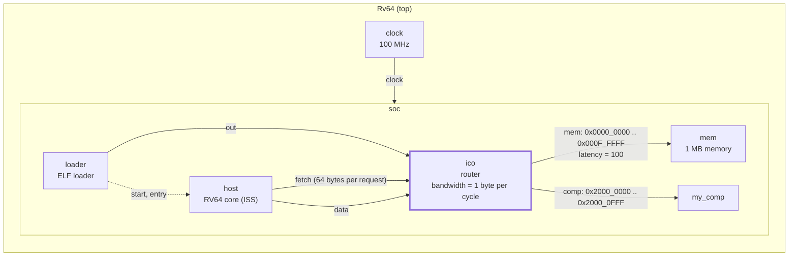
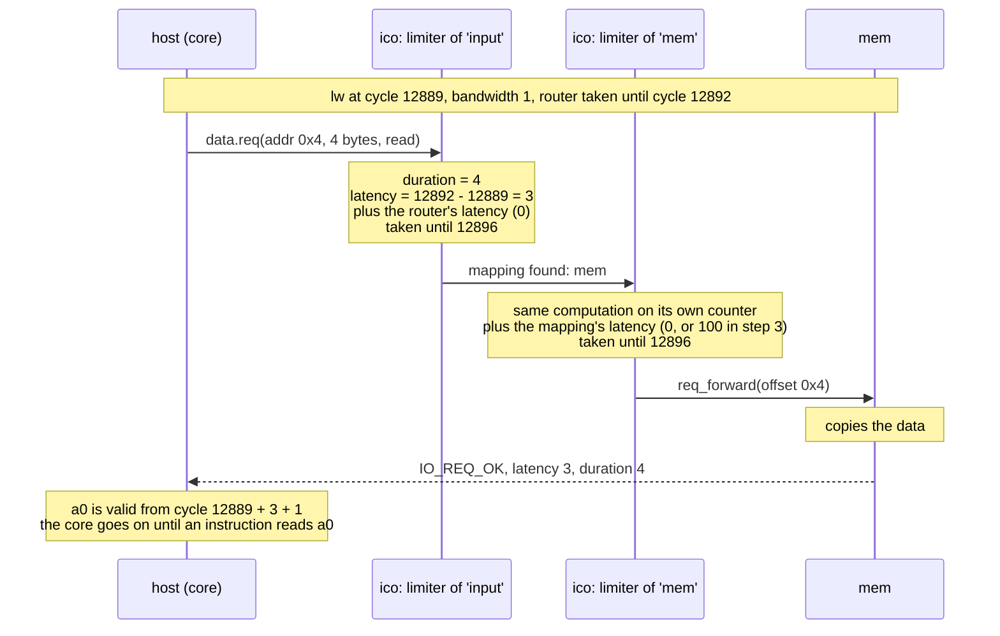
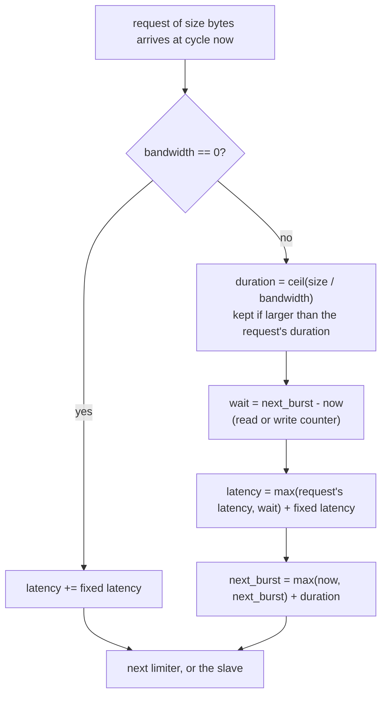

# Tutorial 10: interconnect timing

You give the router a timing model, in the two ways it offers: a fixed
latency on a path, and a bandwidth in bytes per cycle. No C++ is written;
both are arguments of the Python generator. This is how the cost of going
through a crossbar or an AXI link is set, and it is what the stock Snitch
cluster uses for its `narrow_axi`, `wide_axi` and per-core routers.

This is GVSoC developer tutorial 10, written against the pinned source (gvsoc
`93cedc4`). The two code changes in `tutorials.rst` match `solution/`, but
what they do at the pin differs from the text in four ways:

- The text says a latency of 100 on the memory path stalls the core for 100
  cycles at each memory access, and shows a stalled `sd`. At the pin a store
  is not delayed at all, and a load is only delayed at the first instruction
  that uses its value (tutorial 7). What does get slower is the start of the
  run and every instruction fetch (step 3).
- The tutorial's `main.c` loads into a register and never uses it, so
  neither the latency nor the bandwidth changes its loop: one load per cycle
  in every configuration. Step 4 changes `main.c` so that the effect shows.
- The text says the default bandwidth is 4. The default is 0, which means no
  limit.
- The cycle numbers are out of date.

Time: about 20 minutes, plus 2 to 4 minutes of build.

## What you need

- The snax-gvsoc container, with the repo mounted at `/work` and
  `GVSOC_WORKDIR=/work/build` (see `docs/notes/NOTES.md`).
- Tutorial 7 done (`docs/tutorials/7_io_requests.md`): latency on a request,
  and what the RV64 core does with it.

In every new container:

```
source gvsoc/sourceme.sh
export GVSOC_ROOT=/work/gvsoc
```

## The system

Tutorial 4's system, unchanged in structure. The two additions are numbers
on the router: a bandwidth for the whole router, a latency on one mapping.



The loader, the core's fetch port and the core's data port are all bound to
the same input of the router, `input`. This matters in step 5.

## Step 1: copy the tutorial out of the GVSoC tree

From `/work`:

```
cd tutorials
T=/work/gvsoc/engine/docs/developer_manual/tutorials
cp -r $T/10_how_to_customize_an_interconnect_timing .
cd 10_how_to_customize_an_interconnect_timing
```

`my_comp.cpp` and `my_comp.py` are tutorial 4's and are not touched.
`main.c` already has the loop of the tutorial text: 20 times four loads of
the word at address 4. `solution/` holds only `my_system.py`.

## Step 2: build and run the starting point

```
make gvsoc all run
```

Expected: the build, then the `gvrun` line and nothing else. The program
prints nothing. The "before", with instruction traces:

```
make run runner_args="--trace=insn" 2>&1 | grep "main:0" | head -9
make run runner_args="--trace=insn" 2>&1 | grep insn | tail -1
```

Expected (lines shortened):

```
1570000: 157: [/soc/host/insn ] main:0  M 0000000000002f08 c.li     a5, 0, 14
1580000: 158: [/soc/host/insn ] main:0  M 0000000000002f0a lw       a4, 4(0)  a4=0000000000000000 ...
1590000: 159: [/soc/host/insn ] main:0  M 0000000000002f0e lw       a4, 4(0)  a4=0000000000000000 ...
1600000: 160: [/soc/host/insn ] main:0  M 0000000000002f12 lw       a4, 4(0)  a4=0000000000000000 ...
1610000: 161: [/soc/host/insn ] main:0  M 0000000000002f16 lw       a4, 4(0)  a4=0000000000000000 ...
1620000: 162: [/soc/host/insn ] main:0  M 0000000000002f1a c.addiw  a5, a5, ffffffffffffffff ...
1630000: 163: [/soc/host/insn ] main:0  M 0000000000002f1c c.bnez   a5, 0, ffffffffffffffee ...
1660000: 166: [/soc/host/insn ] main:0  M 0000000000002f0a lw       a4, 4(0)  a4=0000000000000000 ...
1670000: 167: [/soc/host/insn ] main:0  M 0000000000002f0e lw       a4, 4(0)  a4=0000000000000000 ...
3410000: 341: [/soc/host/insn ] exit:0  M 0000000000001018 ebreak   0, 0, 1
```

One load per cycle, 8 cycles per iteration (6 instructions and 2 for the
taken branch), last instruction at cycle 341.

## Step 3: a latency on one path

In `my_system.py`, add `latency=100` to the mapping of the memory:

```python
        ico.o_MAP(mem.i_INPUT(), 'mem', base=0x00000000, size=0x00100000, rm_base=True, latency=100)
```

No rebuild is needed: the latency is a property of the router, read from
`gvsoc_config.json` at run time.

```
make run runner_args="--trace=insn" 2>&1 | grep "main:0" | head -5
make run runner_args="--trace=insn" 2>&1 | grep insn | tail -1
```

Expected (lines shortened):

```
12570000: 1257: [/soc/host/insn ] main:0  M 0000000000002f08 c.li  a5, 0, 14
13580000: 1358: [/soc/host/insn ] main:0  M 0000000000002f0a lw    a4, 4(0)  a4=0000000000000000 ...
13590000: 1359: [/soc/host/insn ] main:0  M 0000000000002f0e lw    a4, 4(0)  a4=0000000000000000 ...
13600000: 1360: [/soc/host/insn ] main:0  M 0000000000002f12 lw    a4, 4(0)  a4=0000000000000000 ...
13610000: 1361: [/soc/host/insn ] main:0  M 0000000000002f16 lw    a4, 4(0)  a4=0000000000000000 ...
20390000: 2039: [/soc/host/insn ] exit:0  M 0000000000001018 ebreak 0, 0, 1
```

The program now ends at cycle 2039 where it ended at cycle 341, but the
loads in `main` still run one per cycle. Every one of them got a latency of
100 from the router; the core does not wait, because `a4` is never read
(tutorial 7: a load's latency is paid at the first use of the value). To see
where the 1698 cycles went:

```
make run runner_args="--trace=insn --trace=prefetcher --trace-level=trace" 2>&1 | grep "insn\|prefetcher" | head -7
```

Expected (lines shortened):

```
1030000: 103: [/soc/host/prefetcher ] Fetch request (addr: 0xbc0, size: 0x40)
1030000: 103: [/soc/host/insn       ] _start:0  M 0000000000000bf4 auipc  sp, 0x0 ...
2040000: 204: [/soc/host/insn       ] _start:0  M 0000000000000bf8 addi   sp, sp, fffffffffffffe7c ...
2050000: 205: [/soc/host/insn       ] _start:0  M 0000000000000bfc auipc  t0, 0x0 ...
2060000: 206: [/soc/host/prefetcher ] Fetch request (addr: 0xc00, size: 0x40)
2060000: 206: [/soc/host/insn       ] _start:0  M 0000000000000c00 addi   t0, t0, 1a ...
3070000: 307: [/soc/host/insn       ] _start:0  M 0000000000000c04 csrrw  0, t0, mtvec ...
```

Three things pay the latency, since all three go through the `mem` mapping:

- The loader. Its write of the ELF gets a latency of 100, and it waits that
  long before starting the core: the first instruction is at cycle 103, not
  cycle 3.
- Instruction fetch. The core fetches 64 bytes at a time into a one-line
  buffer; each time the program counter leaves the line there is a new fetch
  request, and the instruction after it comes 101 cycles later. This run has
  14 fetch requests.
- Two loads of the start-up code whose value is used right away, 100 and 98
  cycles.

100 + 14 x 100 + 100 + 98 = 1698. The stores of the start-up code are not
delayed.

## Step 4: use the loaded values

Replace `main.c` with:

```c
#include <stdio.h>
#include <stdint.h>

int main()
{
    uint32_t sum = 0;

    for (int i=0; i<20; i++)
    {
        // Each loaded value is now used, so the core has to wait for it.
        sum += *(volatile uint32_t *)0x00000004;
        sum += *(volatile uint32_t *)0x00000004;
        sum += *(volatile uint32_t *)0x00000004;
        sum += *(volatile uint32_t *)0x00000004;
    }

    printf("sum 0x%x\n", sum);

    return 0;
}
```

Only the program changes:

```
make all run
make run runner_args="--trace=insn" 2>&1 | grep "main:0" | sed -n 5,16p
```

The first command prints `sum 0x0` (the word at address 4 is 0). Expected
from the second (lines shortened):

```
13610000: 1361: [/soc/host/insn ] main:0  M 0000000000002f20 lw       a5, 4(0) ...
13620000: 1362: [/soc/host/insn ] main:0  M 0000000000002f24 lw       a0, 4(0) ...
13630000: 1363: [/soc/host/insn ] main:0  M 0000000000002f28 lw       a2, 4(0) ...
13640000: 1364: [/soc/host/insn ] main:0  M 0000000000002f2c lw       a3, 4(0) ...
13650000: 1365: [/soc/host/insn ] main:0  M 0000000000002f30 c.addw   a5, a5, a0 ...
14650000: 1465: [/soc/host/insn ] main:0  M 0000000000002f32 c.addw   a5, a5, a2 ...
14660000: 1466: [/soc/host/insn ] main:0  M 0000000000002f34 c.addw   a5, a5, a3 ...
14670000: 1467: [/soc/host/insn ] main:0  M 0000000000002f36 c.addiw  a4, a4, ffffffffffffffff ...
14680000: 1468: [/soc/host/insn ] main:0  M 0000000000002f38 c.addw   a1, a1, a5 ...
14690000: 1469: [/soc/host/insn ] main:0  M 0000000000002f3a c.bnez   a4, 0, ffffffffffffffe6 ...
14720000: 1472: [/soc/host/insn ] main:0  M 0000000000002f20 lw       a5, 4(0) ...
14730000: 1473: [/soc/host/insn ] main:0  M 0000000000002f24 lw       a0, 4(0) ...
```

The four loads still go out in four consecutive cycles. The first `c.addw`
needs `a0`, which is valid 100 cycles after its load, so the instruction
after it is at cycle 1465 (load cycle 1362 + latency 100 + 3, as in tutorial
7). By then `a2` and `a3` have arrived too, and the other two additions do
not wait. An iteration takes 111 cycles where it takes 12 without the
latency: four loads cost one latency, not four. A latency delays each
request; it does not make the requests wait for each other.

## Step 5: a bandwidth

In `my_system.py`, remove the `latency=100` of step 3 and give the router a
bandwidth of 1 byte per cycle:

```python
        ico = interco.router.Router(self, 'ico', bandwidth=1)
```

```python
        ico.o_MAP(mem.i_INPUT(), 'mem', base=0x00000000, size=0x00100000, rm_base=True)
```

Again no rebuild:

```
make run
make run runner_args="--trace=insn" 2>&1 | grep "main:0" | sed -n 15,25p
```

The first command prints `sum 0x0`. Expected from the second, the second
iteration of the loop (lines shortened):

```
128880000: 12888: [/soc/host/insn ] main:0  M 0000000000002f20 lw       a5, 4(0) ...
128890000: 12889: [/soc/host/insn ] main:0  M 0000000000002f24 lw       a0, 4(0) ...
128900000: 12890: [/soc/host/insn ] main:0  M 0000000000002f28 lw       a2, 4(0) ...
128910000: 12891: [/soc/host/insn ] main:0  M 0000000000002f2c lw       a3, 4(0) ...
128920000: 12892: [/soc/host/insn ] main:0  M 0000000000002f30 c.addw   a5, a5, a0 ...
128950000: 12895: [/soc/host/insn ] main:0  M 0000000000002f32 c.addw   a5, a5, a2 ...
128990000: 12899: [/soc/host/insn ] main:0  M 0000000000002f34 c.addw   a5, a5, a3 ...
129030000: 12903: [/soc/host/insn ] main:0  M 0000000000002f36 c.addiw  a4, a4, ffffffffffffffff ...
129040000: 12904: [/soc/host/insn ] main:0  M 0000000000002f38 c.addw   a1, a1, a5 ...
129050000: 12905: [/soc/host/insn ] main:0  M 0000000000002f3a c.bnez   a4, 0, ffffffffffffffe6 ...
129080000: 12908: [/soc/host/insn ] main:0  M 0000000000002f20 lw       a5, 4(0) ...
```

Now the loads do wait for each other. A 4-byte load takes the router for 4
cycles, so each value arrives 4 cycles after the one before, and each
addition waits for its own (cycles 12895, 12899, 12903). An iteration takes
20 cycles. What the router computed is in its trace:

```
make run runner_args="--trace=ico/trace --trace-level=trace" 2>&1 | grep "1288[89]: \|1289[01]: " | grep Updating
```

Expected, two lines per load (input side, then output side):

```
128880000: 12888: [/soc/ico/trace ] Updating read burst bandwidth cyclestamp (bandwidth: 1, next_burst: 12892)
128880000: 12888: [/soc/ico/trace ] Updating read burst bandwidth cyclestamp (bandwidth: 1, next_burst: 12892)
128890000: 12889: [/soc/ico/trace ] Updating read burst bandwidth cyclestamp (bandwidth: 1, next_burst: 12896)
128890000: 12889: [/soc/ico/trace ] Updating read burst bandwidth cyclestamp (bandwidth: 1, next_burst: 12896)
128900000: 12890: [/soc/ico/trace ] Updating read burst bandwidth cyclestamp (bandwidth: 1, next_burst: 12900)
128900000: 12890: [/soc/ico/trace ] Updating read burst bandwidth cyclestamp (bandwidth: 1, next_burst: 12900)
128910000: 12891: [/soc/ico/trace ] Updating read burst bandwidth cyclestamp (bandwidth: 1, next_burst: 12904)
128910000: 12891: [/soc/ico/trace ] Updating read burst bandwidth cyclestamp (bandwidth: 1, next_burst: 12904)
```

`next_burst` is the cycle from which the router is free again. The load at
cycle 12889 finds it busy until 12892 and gets a latency of 3; the next one
gets 6, the last one 9.

Two more things changed. The first instruction is now at cycle 12127: the
loader's write of 12124 bytes takes 12124 cycles at one byte per cycle. And
the first iteration of the loop is 80 cycles long, because its loads queue
behind the 64-byte fetch of the line the loop is in. The program ends at
cycle 17491.

## Step 6: both, as in the solution

```
make prepare
make run
```

`make prepare` copies `solution/my_system.py`, which has the bandwidth of
step 5 and the latency of step 3 together; `main.c` stays as in step 4.
Expected: `sum 0x0`. With `--trace=insn` the first instruction is at cycle
12227, an iteration takes 120 cycles (20 + 100) and the program ends at
cycle 27057. This is the state of the working copy.

## The code

`my_system.py` after step 6, which is `solution/my_system.py` with comments
added. Only the two marked lines differ from the starting file.

```python
import gvsoc.systree
import gvsoc.runner

import cpu.iss.riscv
import memory.memory
import vp.clock_domain
import interco.router
import utils.loader.loader
import gdbserver.gdbserver
from gvrun.parameter import TargetParameter

import my_comp


class Soc(gvsoc.systree.Component):

    def __init__(self, parent, name, binary):
        super().__init__(parent, name)

        # The router, with a bandwidth of 1 byte per cycle. The bandwidth
        # is one number for the whole router; it is applied per input port
        # and per mapping. 0, the default, means no limit.
        ico = interco.router.Router(self, 'ico', bandwidth=1)        # NEW

        # Tutorial 4's component, on its own mapping with no latency.
        comp = my_comp.MyComp(self, 'my_comp', value=0x12345678)
        ico.o_MAP(comp.i_INPUT(), 'comp', base=0x20000000, size=0x00001000, rm_base=True)

        # The memory. latency=100 is added to every request that goes out
        # through this mapping: loads, stores, instruction fetches and the
        # loader's write alike.
        mem = memory.memory.Memory(self, 'mem', size=0x00100000)
        ico.o_MAP(mem.i_INPUT(), 'mem', base=0x00000000, size=0x00100000, rm_base=True, latency=100)  # NEW

        # Fetch and data of the core go to the same router input, 'input'.
        # They share one bandwidth limiter on the way in.
        host = cpu.iss.riscv.Riscv(self, 'host', isa='rv64imafdc', binaries=[binary])
        host.o_FETCH     ( ico.i_INPUT     ())
        host.o_DATA      ( ico.i_INPUT     ())

        # The loader writes the ELF through the same input, then starts the
        # core. It waits for the time its write took.
        loader = utils.loader.loader.ElfLoader(self, 'loader', binary=binary)
        loader.o_OUT     ( ico.i_INPUT     ())
        loader.o_START   ( host.i_FETCHEN  ())
        loader.o_ENTRY   ( host.i_ENTRY    ())


# Wrapper that gives the system its clock.
class Rv64(gvsoc.systree.Component):

    def __init__(self, parent, name=None):

        super().__init__(parent, name)

        binary = TargetParameter(
            self, name='binary', value=None, description='Binary to be simulated'
        ).get_value()

        clock = vp.clock_domain.Clock_domain(self, 'clock', frequency=100000000)
        soc = Soc(self, 'soc', binary)
        clock.o_CLOCK    ( soc.i_CLOCK     ())


# The top that gvrun instantiates.
class Target(gvsoc.runner.Target):

    description = "Custom system"
    model = Rv64
    name = "test"
```

| Line | What it does |
|---|---|
| `Router(self, 'ico', bandwidth=1)` | `bandwidth`: bytes per cycle (`gvsoc/core/models/interco/router.py`). A request of `size` bytes takes the router for `ceil(size / bandwidth)` cycles, and a request that arrives while the router is taken gets the remaining cycles as latency. Stored as the property `bandwidth` of `/soc/ico`. |
| `o_MAP(..., latency=100)` | `latency`: cycles added to every request routed through this mapping. Stored in the mapping's entry of the property `mappings`. |
| `Router(..., latency=n)` (not in the solution) | The same, for every request whatever its mapping. Tried in "Beyond the tutorial". |
| `sum += *(volatile uint32_t *)0x00000004;` in `main.c` | A load whose value is read by a later instruction. Without the use, this core never waits for a load. |

## How it works

**The router only writes numbers into the request.** The router of these
tutorials (`interco/router/router.cpp`, the synchronous one) forwards a
request to its slave inside the master's call, as before. Its timing model
is two fields of the request (`vp::IoReq` in `vp/itf/io.hpp`): `latency`,
the number of cycles until the request starts being served, and `duration`,
the number of cycles the transfer itself takes. Nothing is scheduled and the
router holds no request. Whether anything waits is up to the master that
reads the fields when the call returns.



**One limiter per input port and one per mapping.** A request passes two of
them: the limiter of the input port it came in through, then the limiter of
the mapping it goes out through. Each limiter has two counters, one for
reads and one for writes: the cycle from which it is free again
(`next_read_burst_cycle`, `next_write_burst_cycle`). What one limiter does
with a request (`BandwidthLimiter::apply_bandwidth`):



The fixed latency is the router's own `latency` argument in an input
limiter and the mapping's `latency` in a mapping limiter. With no bandwidth
the limiter only adds it, which is all step 3 does.

**Latency and duration are not the same thing to a master.** A request that
finds the router free gets latency 0 and a duration of
`ceil(size / bandwidth)`. The RV64 core only reads the latency
(`get_latency()` in `gvsoc/core/models/cpu/iss/src/lsu.cpp` and
`src/prefetch/prefetch_single_line.cpp`), so a single 4-byte load through a
router of 1 byte per cycle costs it nothing. It is the second request,
arriving while the first still holds the router, that gets a latency. The
bandwidth is therefore a limit on the flow, not a cost per access: in step 5
the loop moves 16 bytes in 20 cycles. The loader reads both fields
(`get_full_latency()`, latency plus duration, in
`gvsoc/core/models/utils/loader/loader.cpp`), which is why its one large
write takes its full 12124 cycles.

**Step 5 by hand.** With the four loads at cycles t to t+3 and the router
free at t:

| Load at | Router free from | Latency | Free from, after | Value used by the instruction ending at |
|---|---|---|---|---|
| t | t | 0 | t+4 | |
| t+1 | t+4 | 3 | t+8 | t+1 + 3 + 3 = t+7 |
| t+2 | t+8 | 6 | t+12 | t+2 + 6 + 3 = t+11 |
| t+3 | t+12 | 9 | t+16 | t+3 + 9 + 3 = t+15 |

With t = 12888 these are the cycles 12895, 12899 and 12903 of the trace.

**Fetches use the router too.** The core has a one-line prefetch buffer of
64 bytes. Executing an instruction outside the current line sends a 64-byte
read through the fetch port, also when that line was fetched before. In this
system fetch and data are bound to the same router input and go out through
the same mapping, so they share both limiters: at 1 byte per cycle a fetch
takes the read side for 64 cycles, and a load issued just after it waits. A
loop that stays inside one line fetches once; a loop that crosses a line
boundary fetches twice per iteration (measured below).

**Stores.** The router gives a store its latency like any other request, on
the write counter. This core ignores it (tutorial 7), so on this system a
store is never slowed down by the router, with one exception:
`shared_rw_bandwidth=True` makes reads and writes use one counter, and then
a store pushes back the load after it.

**No rebuild.** `latency`, `bandwidth` and the mappings are properties that
the router model reads from `gvsoc_config.json` when the run starts
(`get_js_config()` in the `Router` constructor). Changing them is a new run,
with no message about the platform tree.

In SNAX-MODEL terms: the router is the xbar; a mapping's latency is the
fixed cost of a path, like the 1-cycle memory read; the bandwidth is the
width of a link in bytes per cycle, like the 512-bit DMA beat per cycle
(64, which is what the stock cluster's `wide_axi` uses).

Worth a thought: the bandwidth limit is enforced by telling each master how
late its request is, and trusting it to wait. What happens to the limit when
a master, like this core on a store, does not?

## Beyond the tutorial

Tried on the check machine. The figures are cycles per loop iteration in
steady state, with three more programs of the same shape as `main.c`: four
loads of `my_comp`'s register at `0x20000000` with the values used (12
cycles with no timing), four stores to memory (8 cycles), and two loads and
two stores to memory in turn (10 cycles). They are not in the working copy.

| Tried | What happens |
|---|---|
| `latency=7` on the `comp` mapping, loads from `comp` | 18 cycles per iteration: 12 + latency - 1. Only requests to `comp` are delayed; the start-up code and the fetches are not. This is how one path gets its own cost. |
| `Router(self, 'ico', latency=5)` and `latency=7` on `comp` | 23 cycles: 12 + (5 + 7) - 1. The global latency and the mapping latency add. The global one also delays every fetch and the loader. |
| `Router(self, 'ico', latency=10)`, `main.c` of step 4 | 21 cycles per iteration; `main` starts at cycle 267 against 157. |
| `bandwidth=2`, loads from `comp` | 14 cycles (20 with `bandwidth=1`, 12 with none). |
| `bandwidth=4` and `bandwidth=8`, `main.c` of step 4 | 12 cycles, as with no limit: a 4-byte load per cycle fits. Only the start is later (`main` at cycle 3279 and 1702), because of the loader and the fetches. |
| `bandwidth=1` and `latency=7` on `comp` | 27 cycles: 20 + 7. Bandwidth wait and latency add. |
| `bandwidth=1`, stores only | 8 cycles, as with no limit. Also 8 with `latency=100` on `mem`. The router counts the stores, the core does not wait. |
| `bandwidth=1`, loads and stores in turn | 11 cycles: reads and writes have separate counters, so only the two loads compete. |
| The same with `shared_rw_bandwidth=True` | 16 cycles: 16 bytes per iteration through one counter. The stores now cost time, through the loads behind them. |
| Fetch on its own input: `host.o_FETCH(ico.i_INPUT(1))`, `bandwidth=1`, loads from `comp` | The first iteration takes 20 cycles where it takes 79: a load to `comp` no longer queues behind a fetch to `mem`, since they now share neither the input nor the mapping. No rebuild needed. |
| The load-and-store loop when it crosses a 64-byte line (code at `0x2f34` to `0x2f46`), `bandwidth=1` | Two fetch requests per iteration, and iterations of 185 and 87 cycles in turn. Compiled with `-falign-loops=64` the loop sits in one line: 11 cycles. With no router timing both versions take 10 cycles, so the fetches only show once the router has a timing. |
| Memory split into two mappings at `0x1000` | The loader's write crosses the boundary; the router splits it into one request per mapping (`Routing to entry` twice in its trace) and the run is otherwise the same. |
| `--stats` with `bandwidth=1` | `/soc/ico`: `reads 239`, `writes 86`, `bytes_read 4821`, `bytes_written 12687`, `read_bandwidth 27.56 MB/s`. The same numbers under `/soc/mem`. There is no counter for the cycles requests were delayed. |
| `--vcd --event=ico` | The router has two signals per mapping, `ico/mem/addr` and `ico/mem/size` (and the same for `comp`), pulsed for each request. |
| A misspelled argument (`bandwith=1`, `latancy=100`) | A Python `TypeError: ... got an unexpected keyword argument`, before the run starts. |
| `synchronous=False` without a rebuild | `Couldn't find component (name: gen_interco_router_router_common_cpp_...)`, exit code 134: the asynchronous router is another C++ model (`router_async.cpp`). `make gvsoc` then took 15 s (9 files). |
| `synchronous=False`, stores only | The stores are 2 cycles apart with no bandwidth and with `bandwidth=4` (12 cycles per iteration), and 4 cycles apart with `bandwidth=1` (18 cycles). This router holds each request and answers later, so the core is stalled at the store itself. |
| `synchronous=False`, `bandwidth=4`, loads from `comp` | 16 cycles (12 + one more cycle per load). With `latency=7` on `comp` also 16: the asynchronous router ignores latencies, as its documentation says. |
| `synchronous=False` and a program that calls `printf` | The run aborts at the first character: `[/soc/host/syscalls] Pending IO response during debug request`, exit code 134. The semihosting code reads the program's memory through the data port and cannot take a pending answer. Binding `o_DATA_DEBUG` straight to the memory does not help; it is not used for this. |

**Read, not run.** The stock Snitch cluster
(`gvsoc/pulp/pulp/snitch/snitch_cluster/snitch_cluster.py`) uses this same
router four times: `wide_axi` and `tcdm_dma_ico` with `bandwidth=64`,
`narrow_axi` with `bandwidth=8`, and one `pe<N>_ico` per core with
`arch.tcdm.bank_width` as bandwidth. None of them sets a latency.

## SNAX-MODEL counterparts

| GVSoC | SNAX-MODEL |
|---|---|
| `Router` | The xbar |
| `latency` on a mapping | The fixed cost of one path, e.g. the 1-cycle memory read |
| `latency` on the router | A fixed cost of the xbar itself, on every path |
| `bandwidth` | Bytes per cycle of a link, e.g. the 512-bit DMA beat per cycle |
| A request's `latency` and `duration` | When a transfer starts and how long it takes |
| `shared_rw_bandwidth` | One channel for reads and writes, or one each |

## Things that can go wrong

- **The loop does not get slower:** the loaded values are not used (the
  tutorial's own `main.c`), or the accesses are stores. Use the `main.c` of
  step 4.
- **Everything gets slower, not only the data accesses:** a latency or a
  bandwidth on the path to the memory also applies to the loader and to
  every instruction fetch. Put the latency on the mapping of the component
  you mean, and give fetch its own router input if it should not share the
  bandwidth.
- **A change in `my_system.py` has no effect in a script that re-runs
  quickly:** delete `__pycache__` next to it.
- **`TypeError: ... unexpected keyword argument`:** a misspelled `latency` or
  `bandwidth`.
- **`Couldn't find component`:** `synchronous=False` needs `make gvsoc`.
- **`Pending IO response during debug request`:** `printf` behind an
  asynchronous router.
- **The build takes minutes:** expected once after switching tutorials.

## Files

| Path | What |
|---|---|
| `tutorials/10_how_to_customize_an_interconnect_timing/my_system.py` | The system, with the router's bandwidth and the latency on `mem` (same as `solution/my_system.py`) |
| `tutorials/10_how_to_customize_an_interconnect_timing/main.c` | The loop of four loads, changed in step 4 to use the values |
| `tutorials/10_how_to_customize_an_interconnect_timing/my_comp.cpp`, `my_comp.py` | Unchanged from tutorial 4 |
| `tutorials/10_how_to_customize_an_interconnect_timing/testset.cfg` | GVSoC's own regression test for this tutorial (`gvtest`); it only checks that the run ends |
| `gvsoc/core/models/interco/router.py` | The generator: `latency`, `bandwidth`, `synchronous`, `shared_rw_bandwidth`, `o_MAP(..., latency=)`, `i_INPUT(id)` |
| `gvsoc/core/models/interco/router/router.cpp` | The synchronous router and its `BandwidthLimiter` |
| `gvsoc/core/models/interco/router/router_async.cpp` | The asynchronous router |
| `gvsoc/engine/engine/include/vp/itf/io.hpp` | `latency` and `duration` of `vp::IoReq` |
| `gvsoc/core/models/cpu/iss/src/prefetch/prefetch_single_line.cpp` | The core's fetch buffer and what it does with a fetch latency |

`build/test/test`, `build/work/` and the `my_system` build are shared with
the other tutorials and overwritten by this one.


