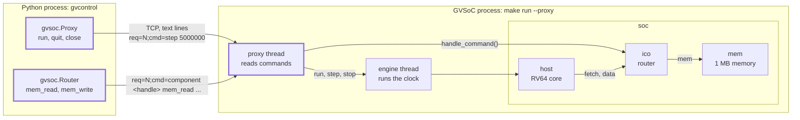
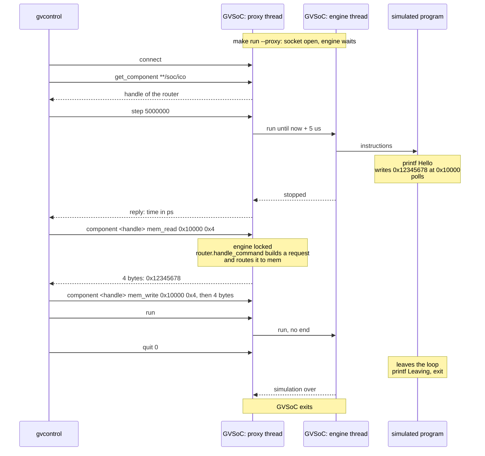

# Tutorial 16: control GVSoC from a Python script

You start GVSoC with its proxy, a socket on which it takes commands, and
drive it from a Python script: run for a given time, read and write memory
through the router, let it run to the end. This is how an outside tool (a
test driver, a viewer, SNAX-FORGE) steps a simulation and looks inside it
without touching the models.

This is GVSoC developer tutorial 16, written against the pinned source (gvsoc
`93cedc4`). The two files in `tutorials.rst` match `solution/`, but:

- The option the text gives to start the proxy,
  `--config-opt=**/gvsoc/proxy/enabled=true`, does nothing at the pin: the
  run starts with no proxy. The options are `--proxy` and `--proxy-port`.
- The text does not mention `make launch`, the script the tutorial's own
  test uses, nor `gvrun --control-script`, which does the whole thing in one
  command (step 7).

Time: about 30 minutes, plus 2 to 5 minutes of build.

## What you need

- The snax-gvsoc container, with the repo mounted at `/work` and
  `GVSOC_WORKDIR=/work/build` (see `docs/notes/NOTES.md`).
- Tutorial 0 done. Nothing from tutorials 1 to 10 is used: the system has no
  component of our own.

In every new container:

```
source gvsoc/sourceme.sh
export GVSOC_ROOT=/work/gvsoc
```

`sourceme.sh` matters here: it puts `/work/build/install/python` on
`PYTHONPATH`, which is where the script finds `gvsoc.gvsoc_control`.

## The system

Tutorial 0's system (core, router, memory, loader). What is new is outside
it: a second process that talks to the first over TCP.



## Step 1: copy the tutorial out of the GVSoC tree

From `/work`:

```
cd tutorials
T=/work/gvsoc/engine/docs/developer_manual/tutorials
cp -r $T/16_how_to_control_gvsoc_from_a_python_script .
cd 16_how_to_control_gvsoc_from_a_python_script
```

`my_system.py` is tutorial 0's, with `o_DATA_DEBUG` bound and a GDB server.
`main.c` prints `Hello`. `launch.py` is the driver of GVSoC's own test.
`solution/` holds the new `main.c` and the control script `gvcontrol`.

## Step 2: build and run the starting point

```
make gvsoc all run
```

Expected: `Hello`. The build took 4 min 27 s on 2 cores (177 files) on the
check machine.

## Step 3: a program that waits for the script

Replace `main.c` with the version below (`solution/main.c` with comments):

```c
#include <stdio.h>
#include <stdint.h>

int main()
{
    printf("Hello\n");

    // Tell the outside "I am here": a magic value at a known address.
    *(volatile uint32_t *)0x00010000 = 0x12345678;

    // Wait until somebody changes it. Nothing in the system does: only the
    // script can, through the proxy.
    while (*(volatile uint32_t *)0x00010000 == 0x12345678)
    {

    }

    printf("Leaving\n");

    return 0;
}
```

```
make all run
```

Expected: `Hello`, and the run never ends. Stop it with Ctrl-C.

## Step 4: the control script

Create `gvcontrol` with the content below (`solution/gvcontrol` with
comments; `make prepare` copies the original), then `chmod +x gvcontrol`:

```python
#!/usr/bin/env python3

import argparse
# The client side of the proxy. Installed with GVSoC, in
# /work/build/install/python/gvsoc/gvsoc_control.py.
import gvsoc.gvsoc_control as gvsoc
import threading
import time

parser = argparse.ArgumentParser(description='Control GVSOC')

parser.add_argument("--host", dest="host", default="localhost", help="Specify host name")
parser.add_argument("--port", dest="port", default=42951, type=int, help="Specify host port")

args = parser.parse_args()


# Connect to the proxy socket of a GVSoC that is already started and waiting.
gv = gvsoc.Proxy(args.host, args.port)

# A handle on the router /soc/ico, to send it memory accesses.
axi = gvsoc.Router(gv, path='**/soc/ico')


while True:
    # Run for 5 000 000 ps (500 cycles at 100 MHz) and come back when the
    # simulation has stopped again.
    gv.run(5000000)
    # Read 4 bytes at the address the program writes. The simulation is
    # stopped while we look.
    value = axi.mem_read_int(0x00010000, 4)
    print ('Got 0x%x' % value)

    if value == 0x12345678:
        break

# The program is in its wait loop. Change the value: this releases it.
axi.mem_write_int(0x00010000, 4, 0)

# No duration: start the simulation and return at once. The program runs to
# its end on its own.
gv.run()
# This client is done, with status 0. GVSoC exits when the simulation is
# over and every client has quit.
gv.quit(0)
# Close the socket and stop the reader thread.
gv.close()

exit(0)
```

| Line | What it does |
|---|---|
| `gvsoc.Proxy(host, port)` | Opens a TCP connection to the proxy and starts a thread that reads its replies. Defaults: `localhost`, 42951. |
| `gvsoc.Router(gv, path='**/soc/ico')` | Asks the engine for the component at that path (command `get_component`) and keeps the handle it returns. The class default is `**/chip/soc/axi_ico`, so the path must be given here. |
| `gv.run(5000000)` | Command `step 5000000`: run for that many picoseconds, then stop. Returns when the engine has stopped. |
| `axi.mem_read_int(0x00010000, 4)` | Command `component <handle> mem_read 0x10000 0x4`: the router model builds a request and sends it through its own routing; the bytes come back on the socket. Little endian. |
| `axi.mem_write_int(0x00010000, 4, 0)` | The same with `mem_write`, the bytes following the command on the socket. |
| `gv.run()` | Command `run`: start and do not wait. |
| `gv.quit(0)` | Command `quit 0`: this client leaves, with an exit status. |
| `gv.close()` | Client side only: closes the socket and joins the reader thread. |

## Step 5: run the two together

Start GVSoC with the proxy, in the background so the same terminal can run
the script:

```
make run runner_args="--proxy --proxy-port=42951" &
```

Expected: the `gvrun` line, then

```
Opened proxy on socket 42951
```

and nothing more: GVSoC waits for a client before it runs anything. Then:

```
./gvcontrol --host=localhost --port=42951
```

Expected:

```
Hello
Got 0x12345678
Leaving
```

and both processes end (the shell reports the background job as `Done`).
`Hello` and `Leaving` come from the simulated program, `Got` from the
script. The script ran the simulation for 500 cycles, found the magic value,
wrote 0 over it, and let the program finish.

A second terminal in the same container works as well
(`podman exec -it <container> bash`, then the two `source` / `export`
lines); that was not tried on the check machine.

## Step 6: watch the polling

In `gvcontrol`, make the step five times shorter:

```python
while True:
    gv.run(1000000)                                # CHANGED: was 5000000
    value = axi.mem_read_int(0x00010000, 4)
    print ('Got 0x%x' % value)

    if value == 0x12345678:
        break
```

```
make run runner_args="--proxy --proxy-port=42951" &
./gvcontrol --port=42951
```

Expected:

```
Got 0x57575757
Got 0x57575757
Hello
Got 0x12345678
Leaving
```

(`Hello` can also come one line earlier or later: two processes write to the
same terminal.) After 100 and 200 cycles the program has not written yet and
the script reads what the memory holds before any write, `0x57575757`.
After 300 cycles the value is there. Put `5000000` back afterwards, so the
working copy matches `solution/`.

## Step 7: the two shortcuts

GVSoC's own test of this tutorial uses `launch.py`, which starts `make run`
on a random port, waits for `Opened proxy on socket`, and starts
`gvcontrol`:

```
make launch
```

Expected: the `gvrun` line with a random port, `Opened proxy on socket
<port>`, `Hello`. It stops looking as soon as it has seen `Hello`, so
`Leaving` is not shown.

`gvrun` can also do the whole thing itself. Save this as `ctrl.py`:

```python
import gvsoc.gvsoc_control as gvsoc

# Called by gvrun --control-script, with a proxy that is already connected.
def target_control(gv):
    ico = gvsoc.Router(gv, path='**/soc/ico')
    while True:
        gv.run(1000000)
        value = ico.mem_read_int(0x00010000, 4)
        print('Got 0x%x' % value)
        if value == 0x12345678:
            break
    ico.mem_write_int(0x00010000, 4, 0)
    gv.run()
    return 0
```

```
make run runner_args="--control-script=$PWD/ctrl.py"
```

Expected, in 0.9 s:

```
Opened proxy on socket 5185
Got 0x57575757
Got 0x57575757
Hello
Got 0x12345678
Leaving
```

(the port is random). `gvrun` picks a free port, starts GVSoC, connects,
calls `target_control(proxy)`, and after it returns sends `quit` with the
returned value and waits for the end. One process to start, no port to
choose. `ctrl.py` is not part of the tutorial; keep it or not.

## How it works



**The proxy is a text protocol on a socket.** With `--proxy`, the engine
opens a TCP port (`gvsoc/engine/engine/src/proxy.cpp`), prints
`Opened proxy on socket <port>` and waits for a client before it starts.
Each command is one line, `req=<number>;cmd=<words>`, and each reply one
line, `req=<number>;msg=<text>`, with binary data after it for a memory
read. `gvsoc_control.py` is a thin client: every method formats one such
line. The commands of the engine at the pin: `run`, `step <ps>`,
`step_cycles <clock> <n>`, `stop`, `quit <status>`, `terminate`,
`get_component <path>`, `get_clock_domains`, `get_binaries`, `get_cores`,
`trace add|remove|level`, `event add|remove`, `component <handle> ...`, and
a few for watchpoints.

**Two threads.** The engine thread runs the clock engine, that is the
models. The proxy thread reads the socket. `step` and `run` hand over to the
engine thread; everything else is done by the proxy thread itself, with the
engine locked (`this->gvsoc->lock()` in `proxy.cpp`). A memory access from
the script is therefore also possible while the simulation is running
(tried below).

**A memory access is a command to a component.** `component <handle> ...`
calls the virtual method `handle_command` of that component
(`vp::Block::handle_command` in `vp/block.hpp`), with the rest of the line
as arguments. The router implements `mem_read` and `mem_write`
(`interco/router/router_common.cpp`): it builds a `vp::IoReq` with the debug
flag set and passes it to its own `handle_req`, input port 0. From there it
is an ordinary request: address decoding, the mapping's offset, the slave's
handler. So the script can reach whatever the router reaches, memories and
register windows alike, and any component can offer commands of its own in
the same way (tried below).

**Time is in picoseconds, steps are synchronous.** `gv.run(n)` returns when
the engine has stopped at now + n ps; the reply carries the time, which the
client keeps in `gv.reader.timestamp`. `gv.step_cycles(clock, n)` does the
same in cycles of one clock. `gv.run()` without a duration returns at once
and the simulation runs on beside the script; `gv.stop()` halts it,
`gv.join()` waits for the program to exit.

**Ending.** GVSoC exits when the simulation is over and every client has
sent `quit`. A script that leaves without `quit`, or sends `quit` while the
simulation is stopped, leaves GVSoC waiting forever. Hence the order at the
end of the script: release the program, `run()`, `quit()`, `close()`.

In SNAX-MODEL terms: SNAX-FORGE calls SNAX-MODEL as a Python object and
reads its state directly; with GVSoC the model is another process, and the
proxy is the way to get the same things: step it, read L1 for the memory
viewer, ask a block for its state.

Worth a thought: the program and the script synchronise through a memory
word that the program polls. What would the handshake look like if the
script could talk to an accelerator model directly, with a command of its
own?

## Beyond the tutorial

Tried on the check machine.

| Tried | What happens |
|---|---|
| GVSoC started with `--proxy`, no script | `Opened proxy on socket 42951`, then it waits; nothing is simulated until a client connects. Without `--proxy-port` the port is 42951. |
| The port is taken | `what(): Failed to start proxy`, abort, exit code 134. `launch.py` and `--control-script` pick random ports and retry. |
| `--config-opt=**/gvsoc/proxy/enabled=true` (the tutorial text) | No proxy: the run prints `Hello` and loops forever. |
| Reply of a step | `gv._send_cmd('step 1000000')` returns the time, `'1000000'`, then `'2000000'`. `gv.reader.timestamp` holds the same number. |
| `gv.step_cycles(0, 7)` after 3 us | Returns `'3070000'`. Clock 0 is the first entry of `gv.get_clock_domains()`, which gives `[{'path': '/clock', 'period': 10000, 'frequency': 0, 'cycles': 307}]`; the frequency reads 0 for this 100 MHz clock. |
| `gv.get_binaries()`, `gv.get_cores()` | `['/work/build/test/test']` and `[]` (no core is listed for this core model). |
| `mem_read(0, 0x10000)`, `mem_write(0x20000, 8, bytes(range(8)))` | A 64 KB read in one call works; the 8 bytes read back as written, and `mem_read_int(0x20000, 2)` gives `0x100`. |
| Read of an unmapped address, `mem_read_int(0x30000000, 4)` | No error: it returns whatever was in the buffer (`0xffa0e8c2` in one run). In `router_common.cpp` the status of the access is overwritten by the status of sending the bytes. |
| Write to an unmapped address | `RuntimeError: Memory access failed (err=1)`. |
| `gv.run()`, then a read 0.3 s later | Works while the simulation runs: `0x12345678`. `gv.stop()` then halts it; `gv.reader.timestamp` showed 201 384 350 000 ps, about 20 million cycles in 0.4 s of host time. |
| A step of 10 ms that goes past the end of the program | The step returns when the program exits, with the end time (`'6770000'`, cycle 677); `gv.join()` then gives the exit code 0. |
| `gv.quit(3)` then `gv.terminate()` while the program still loops | GVSoC ends at once with `Platform returned an error (exitcode: 3)`. `terminate` is how a script ends a simulation that would never end. |
| Script leaves without `quit`; or `quit` before any `run` | GVSoC stays, stopped, until it is killed. |
| `gv.trace_add('insn')` in the default build | Nothing is printed: traces are compiled out, and the proxy does not switch builds. |
| The same with `runner_args="--proxy --debug-mode"` | Instruction lines appear from the next step on; `trace_remove` stops them; `trace_add('ico/trace')` with `trace_level('trace')` shows the script's own read as `Received IO req (offset: 0x10000, size: 0x4, is_write: 0)`, like any other request. |
| `gv.event_add('ico')` | The call never returns. In `proxy.cpp` the reply to `event` is written without a flush. Select VCD signals with `--event` on the command line. |
| Time per call | 44 ms for every `run(n)`, `step_cycles`, `mem_read_int` and `mem_write_int`, whatever the step length; 0.26 ms for `get_clock_domains`. 2000 single-cycle steps would take 88 s. |
| The same with two socket options set in the script (code below) | 0.26 to 0.6 ms per call. The 44 ms is TCP waiting, not simulation: the engine sends a step's reply as several small writes, and the client sends a write as command then data. `TCP_QUICKACK` cures the steps and reads, `TCP_NODELAY` the writes. |
| Long steps, with the options | 4 ms for 100 000 cycles, 21 ms for a million: about 50 million cycles per second in the wait loop. |
| The router given `bandwidth=1`, and a 64 KB `mem_read` from the script | The program ends at cycle 96400 against 30864: the script's read took the router's read side for 65536 cycles, and the program's loads waited behind it. It also counts in the router's statistics. The router does not look at the debug flag; the memory model does. With no bandwidth on the router a script access changes no timing. |
| A component with its own command (code below), added to this system for the test | `gv._send_cmd('component %s get_state' % handle)` returns the string the model built, `'value=305419896 nb_access=0 cycle=0'`; `set_value 0x55` changes its register. An unknown command returns what the model returns for it (`'err=1'`). |
| The same component's register read through the router, `mem_read_int(0x20000000, 4)` | Arrives in the model's request handler as a normal request with `req->is_debug()` true, at the current cycle. A 2-byte read that the model refuses with `IO_REQ_INVALID` raises nothing in the script (the read case above). |
| Paths for `get_component` | `**/soc/my_comp`, `soc/my_comp` and `**/my_comp` give the handle; `/soc/my_comp` and `my_comp` give `0x0`, with no error. |
| `gvsoc.Router(gv, path='**/soc/nothing')`, then a read | The handle is `0x0`; on the first command GVSoC crashes (`Segmentation fault`, exit code 139) and the script waits forever for the reply. |

**Fast calls.** Put this after `gvsoc.Proxy(...)`; it changes nothing in
GVSoC:

```python
import socket

class QuickAck:
    # Stands in for the proxy socket in the reader thread: before every
    # read, ask the kernel to acknowledge at once, so that the engine's
    # next small write is not held back for 40 ms.
    def __init__(self, sock): self.sock = sock
    def recv(self, n):
        self.sock.setsockopt(socket.IPPROTO_TCP, socket.TCP_QUICKACK, 1)
        return self.sock.recv(n)
    def __getattr__(self, name): return getattr(self.sock, name)

gv.reader.socket = QuickAck(gv.socket)
# Send the command line at once, without waiting for the data that follows.
gv.socket.setsockopt(socket.IPPROTO_TCP, socket.TCP_NODELAY, 1)
```

**A command of one's own.** In the model (a tutorial 1 component):

```cpp
#include <vp/proxy.hpp>

    // in the class
    std::string handle_command(gv::GvProxy *proxy, FILE *req_file, FILE *reply_file,
        std::vector<std::string> args, std::string req) override;

std::string MyComp::handle_command(gv::GvProxy *proxy, FILE *req_file, FILE *reply_file,
    std::vector<std::string> args, std::string req)
{
    // args is the command line after "component <handle>".
    if (args[0] == "get_state")
    {
        // The returned string is the reply the script gets.
        return "value=" + std::to_string(this->value) + " nb_access=" + std::to_string(this->nb_access)
            + " cycle=" + std::to_string(this->clock.get_cycles());
    }
    else if (args[0] == "set_value" && args.size() == 2)
    {
        this->value = strtoul(args[1].c_str(), NULL, 0);
        return "ok";
    }
    return "err=1";
}
```

In the script:

```python
h = gv._get_component('**/soc/my_comp')
print(gv._send_cmd('component %s get_state' % h))
```

The method runs in the proxy thread with the engine locked. `_get_component`
and `_send_cmd` are internal names of `gvsoc_control.py`; the classes it
ships (`Router`, `Testbench`, ...) are wrappers around exactly these two
calls.

## SNAX-MODEL counterparts

| GVSoC | SNAX-MODEL |
|---|---|
| The proxy and `gvsoc_control.Proxy` | Calling the model from Python: SNAX-FORGE holds the model object |
| `gv.run(ps)`, `gv.step_cycles(clock, n)` | Running the event loop up to a time |
| `Router.mem_read` / `mem_write` | Reading and presetting memory contents, e.g. L1 for the memory viewer |
| `handle_command` in a component | A method on a block that the flow calls for its state |
| `--control-script` | The flow script that sets up, runs and collects one scenario |

## Things that can go wrong

- **`ModuleNotFoundError: No module named 'gvsoc'`:** `source
  gvsoc/sourceme.sh` was not done in this terminal.
- **`ConnectionRefusedError`:** GVSoC is not started yet, or on another
  port.
- **`Failed to start proxy`:** the port is in use, often by a GVSoC left
  over from an earlier try. `pkill gvsoc_launcher`, or another port.
- **GVSoC never exits:** the script left without `quit`, or sent `quit`
  while the simulation was stopped. End scripts with `run()`, `quit()`,
  `close()`, or with `quit()`, `terminate()` when the program never ends.
- **`Permission denied` on `./gvcontrol`:** `chmod +x gvcontrol`.
- **The script is slow, about 23 calls per second:** the 44 ms per call; use
  the socket options above or longer steps.
- **A read returns nonsense:** the address is not mapped; reads do not
  report errors.
- **`Segmentation fault` in GVSoC and a script that hangs:** the path given
  to `gvsoc.Router` matched nothing, so its handle is `0x0`.
- **The build takes minutes:** expected once after switching tutorials.

## Files

| Path | What |
|---|---|
| `tutorials/16_how_to_control_gvsoc_from_a_python_script/main.c` | The program that writes a magic value and waits |
| `tutorials/16_how_to_control_gvsoc_from_a_python_script/gvcontrol` | The control script (same as `solution/gvcontrol`) |
| `tutorials/16_how_to_control_gvsoc_from_a_python_script/launch.py` | Starts GVSoC and `gvcontrol` together; used by `make launch` and by `testset.cfg` |
| `tutorials/16_how_to_control_gvsoc_from_a_python_script/my_system.py` | Tutorial 0's system |
| `gvsoc/engine/python/gvsoc/gvsoc_control.py` | The Python client: `Proxy`, `Router`, and wrappers for other stock models |
| `gvsoc/engine/engine/src/proxy.cpp` | The engine side: the socket, the command loop |
| `gvsoc/core/models/interco/router/router_common.cpp` | The router's `mem_read` / `mem_write` commands |
| `gvsoc/engine/engine/include/vp/block.hpp` | `handle_command`, the hook for a component's own commands |
| `gvsoc/engine/python/gvsoc/runner_gvrun2.py` | `--proxy`, `--proxy-port`, `--control-script`, `--debug-mode` |

`build/test/test`, `build/work/` and the `my_system` build are shared with
the other tutorials and overwritten by this one.

