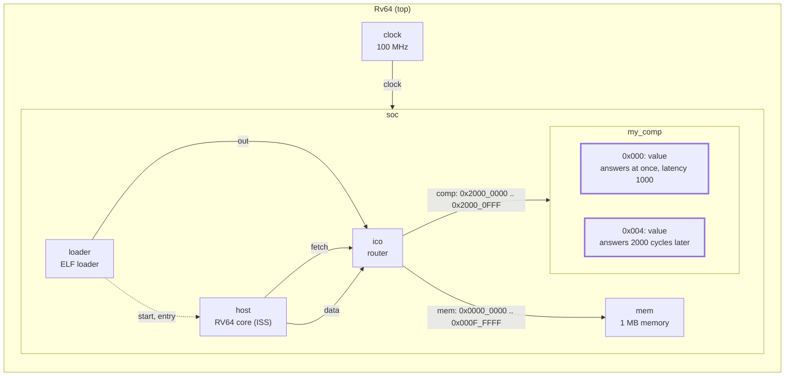
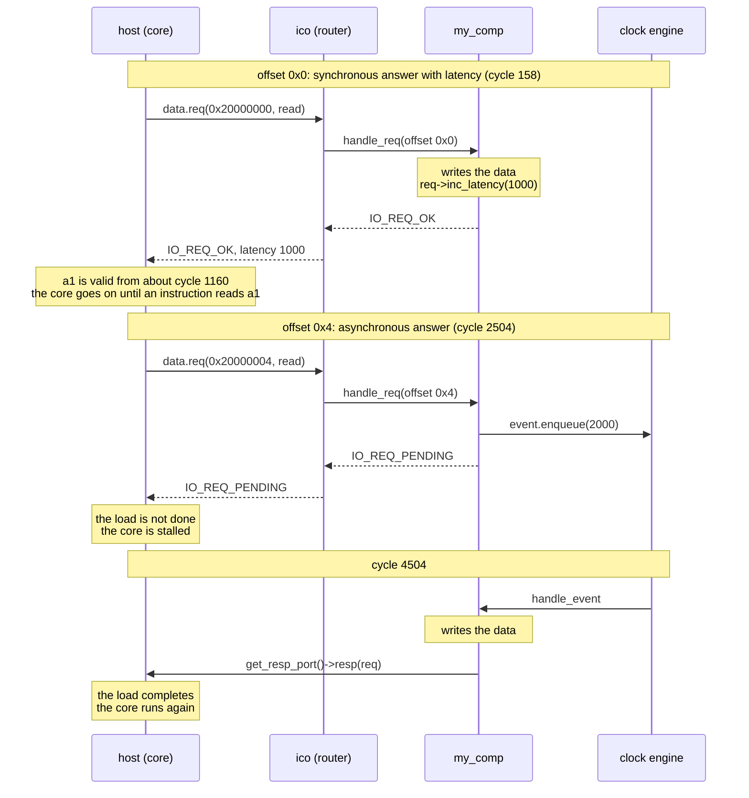

# Tutorial 7: the IO request interface

You make a memory-mapped request take time, in the two ways the `io`
interface offers: a synchronous answer that carries a latency, and an
asynchronous answer, where the model keeps the request and replies later.
This is how a register window, a memory or an accelerator makes the core
wait.

This is GVSoC developer tutorial 7, written against the pinned source (gvsoc
`93cedc4`). The code in `tutorials.rst` matches `solution/`, but three things
differ at the pin:

- The tutorial's `main.c` never reads the second register, so the
  asynchronous path does not run until you add a line (step 4).
- The text says a latency stalls the core at the load. The RV64 core now
  lets the load finish and stalls at the first instruction that uses the
  loaded value (step 3).
- The cycle numbers are out of date.

The tutorial covers the slave side only. A component that issues requests
itself (a streamer) is step 15.

Time: about 45 minutes, plus 2 to 3 minutes of build.

## What you need

- The snax-gvsoc container, with the repo mounted at `/work` and
  `GVSOC_WORKDIR=/work/build` (see `docs/notes/NOTES.md`).
- Tutorials 3 and 6 done (`docs/tutorials/3_system_traces.md`,
  `6_timing.md`). Tutorial 7 starts from tutorial 3's single component and
  uses tutorial 6's clock event.

In every new container:

```
source gvsoc/sourceme.sh
export GVSOC_ROOT=/work/gvsoc
```

## The system

Tutorial 1's system. The component gets two registers that answer in
different ways:



## Step 1: copy the tutorial out of the GVSoC tree

From `/work`:

```
cd tutorials
T=/work/gvsoc/engine/docs/developer_manual/tutorials
cp -r $T/7_how_to_use_the_io_request_interface .
cd 7_how_to_use_the_io_request_interface
```

The starting `my_comp.cpp` is tutorial 3's model with a member
`vp::IoReq *pending_req` already declared, and `IO_REQ_INVALID` for anything
but a 4-byte access at offset 0. `solution/` holds only `my_comp.cpp`.

## Step 2: build and run the starting point

```
make gvsoc all run
```

Expected: `Hello, got 0x12345678 from my comp`. The build took 2 min 23 s on
2 cores (197 files); later builds in this page take about 4 s. The "before",
with traces:

```
make run runner_args="--trace=my_comp/trace --trace=insn --trace-level=debug" 2>&1 | grep -A2 "Received request"
```

Expected (lines shortened):

```
1580000: 158: [/soc/my_comp/trace            ] Received request at offset 0x0, size 0x4, is_write 0
1580000: 158: [/soc/host/insn                ] main:0    M 0000000000002f2c c.lw    a1, 0(a5)  ...
1590000: 159: [/soc/host/insn                ] main:0    M 0000000000002f2e c.addi  sp, sp, fffffffffffffff0  ...
```

## Step 3: a synchronous answer with a latency

In `my_comp.cpp`, in `handle_req`, add one line to the branch for offset 0:

```cpp
        if (req->get_addr() == 0)
        {
            *(uint32_t *)req->get_data() = _this->value;
            req->inc_latency(1000);
            return vp::IO_REQ_OK;
        }
```

The handler still gives the data and returns in the same call. The latency
is a number in the request that tells the master "this took 1000 cycles".

```
make gvsoc all run
make run runner_args="--trace=my_comp/trace --trace=insn --trace-level=debug" 2>&1 | grep -A10 "Received request"
```

The first command prints the same `Hello` line. Expected from the second
(lines shortened):

```
1580000: 158: [/soc/my_comp/trace            ] Received request at offset 0x0, size 0x4, is_write 0
1580000: 158: [/soc/host/insn                ] main:0    M 0000000000002f2c c.lw        a1, 0(a5)  ...
1590000: 159: [/soc/host/insn                ] main:0    M 0000000000002f2e c.addi      sp, sp, fffffffffffffff0  ...
1600000: 160: [/soc/host/insn                ] main:0    M 0000000000002f30 addi        a0, 0, 260  ...
1610000: 161: [/soc/host/insn                ] main:0    M 0000000000002f34 c.sdsp      ra, 8(sp)  ...
1620000: 162: [/soc/host/insn                ] main:0    M 0000000000002f36 jal         ra, ffffffffffffffb4  ...
1640000: 164: [/soc/host/insn                ] printf:0  M 0000000000002eea c.addi16sp  sp, sp, ffffffffffffffa0  ...
1650000: 165: [/soc/host/insn                ] printf:0  M 0000000000002eec addi        t1, sp, 28  ...
1660000: 166: [/soc/host/insn                ] printf:0  M 0000000000002ef0 c.lui       t3, 0x1000  ...
1670000: 167: [/soc/host/insn                ] printf:0  M 0000000000002ef2 c.sdsp      a1, 28(sp)  ...
11610000: 1161: [/soc/host/insn                ] printf:0  M 0000000000002ef4 c.sdsp      a2, 30(sp)  ...
```

The load at cycle 158 does not stall. The core runs on until `c.sdsp a1` at
cycle 167, the first instruction that reads `a1`, the register the load
wrote. That instruction waits, and the next one comes at cycle 1161. The
program ends at cycle 2530 where it ended at cycle 1537 before: 993 cycles
more.

## Step 4: an asynchronous answer

Replace `my_comp.cpp` with the version below, `solution/my_comp.cpp` with
comments added (and one unused declaration of the solution left out):

```cpp
#include <vp/vp.hpp>
#include <vp/signal.hpp>
#include <vp/itf/io.hpp>

class MyComp : public vp::Component
{

public:
    MyComp(vp::ComponentConf &config);

private:
    static vp::IoReqStatus handle_req(vp::Block *__this, vp::IoReq *req);
    // Runs when the delayed answer is due.
    static void handle_event(vp::Block *__this, vp::ClockEvent *event);

    vp::IoSlave input_itf;

    uint32_t value;

    // Tutorial 6's clock event, used here to answer a request later.
    vp::ClockEvent event;
    vp::Trace trace;

    // The request we have accepted and not answered yet. The request object
    // belongs to the master and stays valid until we answer.
    vp::IoReq *pending_req;
};


MyComp::MyComp(vp::ComponentConf &config)
    : vp::Component(config), event(this, MyComp::handle_event)
{
    this->input_itf.set_req_meth(&MyComp::handle_req);
    this->new_slave_port("input", &this->input_itf);

    this->value = this->get_js_config()->get_child_int("value");

    this->traces.new_trace("trace", &this->trace);
}


vp::IoReqStatus MyComp::handle_req(vp::Block *__this, vp::IoReq *req)
{
    MyComp *_this = (MyComp *)__this;

    _this->trace.msg(vp::TraceLevel::DEBUG, "Received request at offset 0x%lx, size 0x%lx, is_write %d\n",
        req->get_addr(), req->get_size(), req->get_is_write());

    if (req->get_size() == 4)
    {
        if (req->get_addr() == 0)
        {
            // Synchronous answer with a latency. The data is given now and
            // the call returns now, but the request says "this took 1000
            // cycles", and the master accounts for it. The core stalls.
            *(uint32_t *)req->get_data() = _this->value;
            req->inc_latency(1000);
            return vp::IO_REQ_OK;
        }
        else if (req->get_addr() == 4)
        {
            // Asynchronous answer. Keep the request, schedule the answer,
            // and tell the master it is not done. The data is not written
            // yet.
            _this->pending_req = req;
            _this->event.enqueue(2000);
            return vp::IO_REQ_PENDING;
        }
    }

    return vp::IO_REQ_INVALID;
}


// 2000 cycles later: fill in the data and hand the request back.
void MyComp::handle_event(vp::Block *__this, vp::ClockEvent *event)
{
    MyComp *_this = (MyComp *)__this;

    *(uint32_t *)_this->pending_req->get_data() = _this->value;
    // The request remembers the port it came through. resp() on that port
    // calls the master's response handler, which unstalls the core.
    _this->pending_req->get_resp_port()->resp(_this->pending_req);
}


extern "C" vp::Component *gv_new(vp::ComponentConf &config)
{
    return new MyComp(config);
}
```

| Line | What it does |
|---|---|
| `req->inc_latency(1000);` | Adds 1000 cycles to the latency of this request (`gvsoc/engine/engine/include/vp/itf/io.hpp`). Every component on the path can add its own; the master reads the total when the call returns. |
| `vp::IoReq *pending_req;` | Where the model keeps a request between accepting and answering it. The object is the master's and stays valid until `resp()`. |
| `vp::ClockEvent event;`, `event(this, MyComp::handle_event)` | Tutorial 6's event, here to schedule the answer. |
| `_this->pending_req = req;` | Remember the request. |
| `_this->event.enqueue(2000);` | The answer is due in 2000 cycles. |
| `return vp::IO_REQ_PENDING;` | "Accepted, not done; I will call you back." The master must not use the data yet. |
| `*(uint32_t *)_this->pending_req->get_data() = _this->value;` | In the callback: the data, written at the time of the answer. `get_data()` still points at the core's destination register. |
| `_this->pending_req->get_resp_port()->resp(_this->pending_req);` | The answer. `get_resp_port()` is the slave port the request came in through, stored in the request by the master's `req()` call. `resp()` calls the master's response handler. |

The tutorial's `main.c` only reads offset 0. Add a second read, before
`return 0;`:

```c
    printf("Hello, got 0x%x at 0x20000004\n", *(uint32_t *)0x20000004);
```

Build and run:

```
make gvsoc all run
```

Expected:

```
Hello, got 0x12345678 from my comp
Hello, got 0x12345678 at 0x20000004
```

## Step 5: see the pending request

```
make run runner_args="--trace=my_comp/trace --trace=insn --trace-level=debug" 2>&1 | grep -B1 -A3 "Received request at offset 0x4"
```

Expected (lines shortened):

```
25030000: 2503: [/soc/host/insn                ] main:0  M 0000000000002f5a lui   a5, 0x20000000  ...
25040000: 2504: [/soc/my_comp/trace            ] Received request at offset 0x4, size 0x4, is_write 0
45040000: 4504: [/soc/host/insn                ] main:0  M 0000000000002f5e c.lw  a1, 4(a5)  a1=0000000012345678  ...
45050000: 4505: [/soc/host/insn                ] main:0  M 0000000000002f60 addi  a0, 0, 280  ...
45060000: 4506: [/soc/host/insn                ] main:0  M 0000000000002f64 jal   ra, ffffffffffffffa6  ...
```

The request arrives at cycle 2504. This time the load itself is held: its
trace line only appears at cycle 4504, 2000 cycles later, with the value
the callback wrote. No instruction runs in between.

## How it works

The two answers side by side:



**Four answers to a request.** The handler's return value is the protocol
(`vp::IoReqStatus` in `io.hpp`):

| Status | Meaning | Who does what next |
|---|---|---|
| `IO_REQ_OK` | Done, in this call. The request's latency says how long it took. | Nothing. |
| `IO_REQ_INVALID` | Error. | The core takes a fault. |
| `IO_REQ_PENDING` | Accepted, not done. | The slave calls `resp(req)` later, exactly once. |
| `IO_REQ_DENIED` | Not accepted now. | The slave calls `grant(req)` when it accepts, then `resp(req)` when done. |

**Latency is a number, not an event.** `inc_latency` only changes a field
of the request. Nothing is scheduled and the model keeps no state, which
makes it the cheap way to say "this access is slow". What the delay means is
up to the master. The RV64 core at the pin puts a "valid from" cycle on the
destination register of the load and stalls only when an instruction reads
that register before then (`Lsu` in
`gvsoc/core/models/cpu/iss/src/lsu.cpp`, the register scoreboard). For a
store there is no destination register, and the latency is not accounted at
all (see "Beyond the tutorial").

**Pending is a contract.** With `IO_REQ_PENDING` the request belongs to the
slave until it calls `resp()`. The core stalls at the instruction itself,
for a load and for a store alike, and nothing but the `resp()` call wakes
it. The model needs state (the request pointer) and something that will
call back (a clock event, or another component's answer).

**The path back.** The master's `req()` stores its side of the binding in
the request (`req->resp_port`). `get_resp_port()->resp(req)` therefore goes
back towards whoever issued the request and ends in the core's
`Lsu::data_response`, without the model knowing who that is. Whether the
router sits in that return path in this system was not checked.

**Latency adds up along the path.** `inc_latency` adds, `set_latency(n)`
keeps the larger of the old value and `n`, and `get_latency()` reads what
earlier components put there. The router contributes its own when it is
given one (step 12). In this system the request arrives with latency 0.

In SNAX-MODEL terms: a latency is a fixed read or write cost of a register
window or a memory; a pending request is a transfer that waits for a block
to become ready.

Worth a thought: a memory bank that is busy until some cycle can tell a
second master so with a latency, or by holding the request. The stock bank
model does the first. What does each choice cost in simulation speed and in
what the master sees?

## Beyond the tutorial

Tried on the check machine, on a copy of `my_comp.cpp` with the mode picked
at run time, and a program that loads the register and uses the value three
instructions later (the load at cycle 158, the use at cycle 161).

| Tried | What happens |
|---|---|
| Load latency 0 or 1 | No stall: the instruction after the use is at cycle 162. |
| Load latency 2, 3, 4, 10, 1000 | The instruction after the use is at cycle 163, 164, 165, 171, 1161: load cycle + latency + 3. The stall is at the use, not at the load. |
| Whole program with latency 1000 on one load | Ends at cycle 1965 where it ended at cycle 966 with latency 0: 999 cycles more. |
| `set_latency(1000)` then `set_latency(500)` | Same as 1000: `set_latency` keeps the larger. |
| `inc_latency(1000)` twice | 2000: it adds. |
| Store with latency 0, 1000 and 100000 | No difference: the program ends at cycle 288 in all three. This core ignores a store's latency. |
| Store answered with `IO_REQ_PENDING`, `resp()` 2000 cycles later | The store at cycle 161 is held until cycle 2161. Pending works for stores. |
| Pending with `enqueue(0)` | `resp()` in the same cycle as the request: the load completes in that cycle. |
| Pending, then `inc_latency(500)` just before `resp()` | The load completes at the `resp()`, and the instruction that uses the value is 500 cycles further: both mechanisms add. |
| Pending, `resp()` never called | The core stays stalled and the run never ends, with no message. It had to be killed. |
| `resp()` called twice | `[/soc/host/exec] Trying to decrease zero stalled counter`, abort, exit code 134. |
| `IO_REQ_DENIED`, `grant(req)` 2000 cycles later, `resp(req)` 2000 cycles after that | The load completes at cycle 4158 with the right value. The core is stalled throughout. |
| Load latency of 1000000000 | The run ends at cycle 1000000965. It took 7.9 s of host time against about 1 s without: waiting is cheap, not free. |

**A blocking register.** Tutorial 6's busy flag is polled by the program. The
other way is a store to `start` that only returns when the run is over:
answer the store with `IO_REQ_PENDING` and call `resp()` from the event
that ends the run. The pending store above is exactly that. Since this core
ignores a store's latency, pending is the only way here to make a store
take time.

**One request at a time.** While a request from the core is pending, the
core is stalled, so `pending_req` cannot be overwritten by a second request
from the same core. With two masters on the router that no longer holds,
and a model that returns `IO_REQ_PENDING` needs a queue or has to deny the
second request.

## SNAX-MODEL counterparts

| GVSoC | SNAX-MODEL |
|---|---|
| `inc_latency(n)` on a request | The read or write cost of a register window; a memory's read latency |
| `IO_REQ_PENDING` and `resp()` | A transfer that completes when a block is ready |
| `IO_REQ_DENIED` and `grant()` | Back-pressure: a port that does not accept in this cycle |
| The core stalled on a pending store | A `wait` step of the controller |

## Things that can go wrong

- **The second register is never read:** the tutorial's `main.c` has no
  access to `0x20000004`. Add the line of step 4.
- **The run never ends:** a request was answered with `IO_REQ_PENDING` and
  `resp()` is never called, or the event that should call it was never
  enqueued.
- **`Trying to decrease zero stalled counter`:** `resp()` was called twice
  for one request.
- **A latency seems to have no effect:** on a load, the stall is at the
  first use of the loaded value, not at the load; look further down the
  instruction trace. On a store, this core ignores it.
- **The value read is wrong after a pending request:** the data must be
  written before `resp()`, in the callback.
- **The build takes minutes:** expected once after switching tutorials.

## Files

| Path | What |
|---|---|
| `tutorials/7_how_to_use_the_io_request_interface/my_comp.cpp` | The model with both kinds of answer |
| `tutorials/7_how_to_use_the_io_request_interface/main.c` | Reads both registers |
| `tutorials/7_how_to_use_the_io_request_interface/my_comp.py`, `my_system.py` | Unchanged from tutorial 3 |
| `tutorials/7_how_to_use_the_io_request_interface/testset.cfg` | GVSoC's own regression test for this tutorial (`gvtest`); it only checks the first `Hello` line |
| `gvsoc/engine/engine/include/vp/itf/io.hpp` | `vp::IoReq`, `vp::IoSlave`, `vp::IoMaster`, the status values |
| `gvsoc/core/models/cpu/iss/src/lsu.cpp` | The core's side: what it does with latency, pending and denied |

`build/test/test`, `build/work/` and the `my_system` build are shared with
the other tutorials and overwritten by this one.


