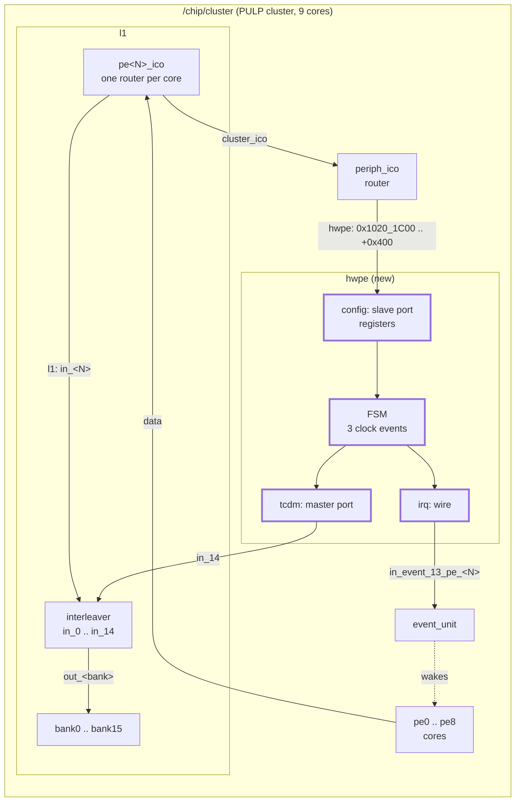
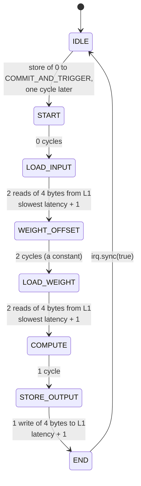
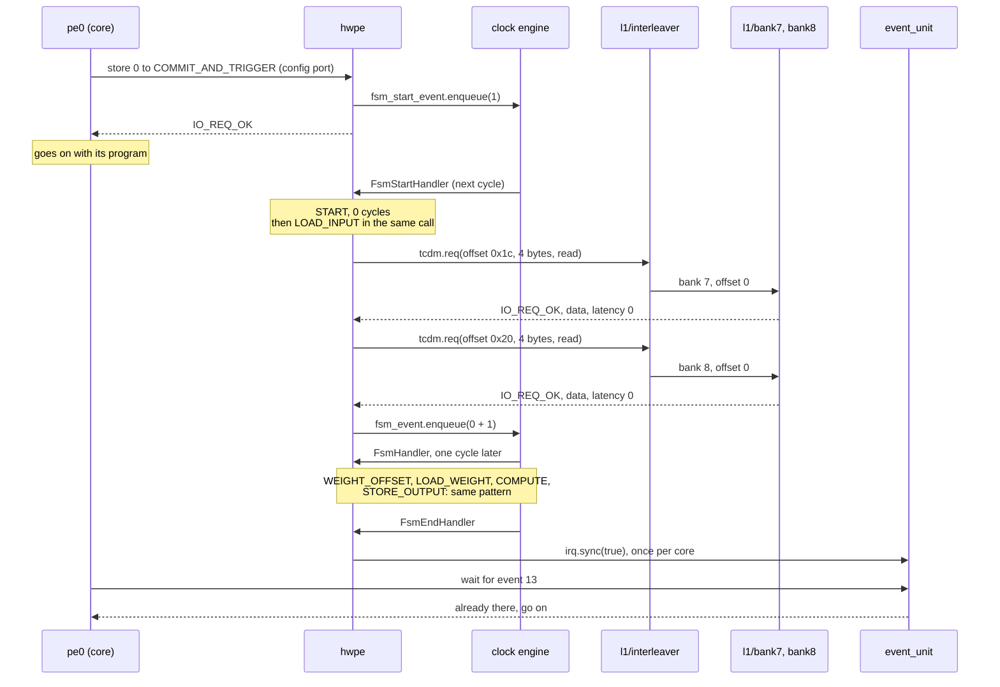

# The HWPE tutorial: a full accelerator model

A reading page. The HWPE tutorial of GVSoC builds a small accelerator for the
PULP cluster: a register window that a core programs, a state machine driven
by clock events, a port through which the accelerator reads and writes L1
itself, and an interrupt line that tells the core it is done. It is the only
tutorial where a component issues its own memory requests, which is what a
SNAX streamer does all day.

GVS1 step 15. Nothing is built on your side. The page says where things are,
walks through the model in reading order, and ties each part to a SNAX
streamer and accelerator.

Written against the pinned source (gvsoc `93cedc4`). SNAX is quoted from
`KULeuven-MICAS/snax_cluster` at `8ebd422` (2026-09-16), files
`docs/tutorial/streamer_design.md`, `csrman_design.md` and `programming.md`;
that is read, not run.

How each statement was checked:

- **read**: from the source at the pin.
- **run**: on the check machine, a 2-core Ubuntu 24.04 at the same pins. The
  final state of the tutorial (all solutions applied) was built once as the
  target `pulp-open-hwpe` and run with the tutorial's prebuilt test program.
- **experiment**: a small component of our own that issues requests, added
  to the tutorial 0 system for the test. Its code is in "The master side,
  tried".

Time: about 60 minutes of reading.

## Where it is

It is not with the other tutorials. They are in the `engine` submodule of
gvsoc; this one is in the `pulp` submodule:

| What | Path, under `gvsoc/pulp/docs/developer_manual/` |
|---|---|
| The text | `tutorials_hwpe.rst` |
| The files | `tutorials/hwpe/` |
| Part 1, a new target | `tutorials/hwpe/create_target/` |
| Part 2, the accelerator in the cluster | `tutorials/hwpe/integrate_hwpe/` |
| Part 3, the model, in 8 tasks | `tutorials/hwpe/model_hwpe/` |
| The final model | `tutorials/hwpe/model_hwpe/solutions/task8/simple_hwpe/` |
| The test programs, source and prebuilt ELF | `tutorials/hwpe/model_hwpe/application/task<N>/` |
| Figures (integration, FSM, datapath) | `images/hwpe/` |

The tutorial works by copying files into the GVSoC tree: `make
create_target_task` copies the `pulp_open` chip to
`gvsoc/pulp/pulp/chips/pulp_open_hwpe/`, and each `make model_hwpe_task<N>`
replaces `gvsoc/pulp/pulp/simple_hwpe/`. So doing it changes the pinned
submodule; reading it does not.

State at the pin (run):

- The setup targets `create_target_task`, `integrate_hwpe_task`,
  `create_target_sol` and `model_hwpe_sol8` work.
- `make integrate_hwpe_sol` fails: it wants
  `integrate_hwpe/solutions/pulp_open_hwpe/cluster.json`, which is not in
  the tree. The patch for `cluster.py` in `solutions_diff/` does not apply
  either. The five integration edits were made by hand from the text.
- `run_tutorial_ci.sh` names two targets that do not exist
  (`create_target_sol_task4`, `integrate_hwpe_sol10`).
- With the edits made by hand, the target builds in 10 min 36 s (2 cores,
  after the other builds) and the last test passes. The text uses the old
  launcher, `gvsoc --target=pulp-open-hwpe --binary <elf> run`; it is still
  installed and works.
- The test programs need the PULP SDK to rebuild; the prebuilt `test` files
  are enough to run.

## The system



Three connections, each of a kind seen in an earlier tutorial except one:

| Connection | Kind | Seen in |
|---|---|---|
| core to `config` | `io` slave: a register window | tutorials 1, 5 |
| `irq` to the event unit | wire | tutorial 2 |
| `tcdm` to L1 | `io` **master**: the accelerator issues requests | new here |

## Part 1 and part 2: the integration

Part 1 only clones a target (`pulp-open-hwpe.py` and the directory
`pulp_open_hwpe/`), so that the cluster can be edited without touching
`pulp_open`. Part 2 puts the accelerator into the cluster. These are all the
edits (read; made by hand for the run):

```python
# cluster.json, under "peripherals": the register window
"hwpe": {
    "mapping": {
        "base": "0x10201c00",
        "size": "0x00000400",
        "remove_offset": "0x10201c00"
    }
},
```

```python
# cluster.py
from pulp.simple_hwpe.hwpe import Hwpe

hwpe = Hwpe(self, 'hwpe')

# 1. the register window, on the peripheral router
periph_ico.add_mapping('hwpe', **self._reloc_mapping(cluster_conf.get_property('peripherals/hwpe/mapping')))
self.bind(periph_ico, 'hwpe', hwpe, 'config')

# 2. the accelerator's own port into L1
self.bind(hwpe, 'tcdm', l1, 'hwpe')

# 3. the interrupt, to the event unit, once per core
hwpe_irq = cluster_conf.get_property('pe/irq').index('acc_1')
for i in range(0, nb_pe):
    self.bind(hwpe, 'irq', event_unit, 'in_event_%d_pe_%d' % (hwpe_irq, i))
```

```python
# l1_subsystem.py: one more input on the interleaver, exposed as 'hwpe'
l1_interleaver_nb_masters = nb_pe + 4 + 1 + 1   # cores, DMA, NE16, and the new one
self.bind(self, 'hwpe', interleaver, 'in_%d' % (nb_pe + 5))
```

```
# gvsoc/pulp/pulp/CMakeLists.txt
add_subdirectory(simple_hwpe)
```

Points worth noting:

- **The accelerator does not go through a router to reach L1.** Its port is
  one more input of the L1 interleaver, next to the cores and the DMA. The
  interleaver picks the bank from the address
  (`gvsoc/core/models/interco/interleaver_impl.cpp`, read): bank =
  `(offset >> 2) & 15`, with no arbitration of its own.
- **The address it sends is an L1 offset, not a bus address.** No router
  subtracts a base for it, so the model does it: `CLUSTER_MASK & pointer`
  turns `0x1000001c` into `0x1c`.
- **This is the old style of generator.** `hwpe.py` is one line,
  `self.set_component('pulp.simple_hwpe.hwpe')`, with the model built by a
  `CMakeLists.txt` (`vp_model(NAME ... SOURCES ...)`), and ports bound by
  name with `self.bind(a, 'port', b, 'port')` and no signature. Tutorials 0
  to 16 use the newer `add_sources` and `i_X` / `o_Y` style. The stock
  Snitch cluster uses the newer one; a SNAX component would too.

## Part 3: the model

The eight tasks grow one class. Read the final state, in this order:
`inc/hwpe.hpp`, `src/hwpe.cpp`, `src/hwpe_fsm.cpp`, `src/input_load.cpp`,
`src/output_store.cpp`. The datapath files (`inc/binconv/`, `inc/buffer/`,
`hwpe_compute.cpp`, `hwpe_weightoffset.cpp`, the two `*_layout.cpp`) are the
arithmetic of a pointwise convolution taken from the Neureka model; they are
plain C++ with no GVSoC in them and can be skipped.

### The class

`inc/hwpe.hpp`, shortened to what matters, with comments added:

```cpp
class Hwpe : public vp::Component
{
public:
  Hwpe(vp::ComponentConf &config);

  // The master port: requests go out through it, into L1.
  vp::IoMaster tcdm_port;
  // One request object, reused for every access the model makes.
  vp::IoReq io_req;

  vp::Trace trace;
  // The FSM state, as a register (an older class than vp::Register).
  vp::reg_32 state;

  // The register file: four job registers and a "job running" flag.
  RegConfigManager<Hwpe> regconfig_manager_instance;

private:
  // The register window and its handler.
  vp::IoSlave cfg_port_;
  static vp::IoReqStatus hwpe_slave(vp::Block *__this, vp::IoReq *req);

  // The "done" line to the event unit.
  vp::WireMaster<bool> irq;

  // A copy of the job registers, taken when the job starts.
  Regconfig reg_config_;
  // One (count, iteration) pair per phase: how far each loop is.
  Iterator input, weight, compute, output;

  // The FSM: one function per phase, each returns how many cycles it takes.
  int  fsm();
  void fsm_loop();
  int64_t input_load();
  int64_t weight_load();
  int64_t weight_offset();
  int64_t compute_output();
  int64_t output_store();

  // Three clock events: start of a job, next step, end of a job.
  vp::ClockEvent *fsm_start_event;
  vp::ClockEvent *fsm_event;
  vp::ClockEvent *fsm_end_event;
  static void FsmStartHandler(vp::Block *__this, vp::ClockEvent *event);
  static void FsmHandler(vp::Block *__this, vp::ClockEvent *event);
  static void FsmEndHandler(vp::Block *__this, vp::ClockEvent *event);
};
```

The constructor (`src/hwpe.cpp`) declares the ports and the events:

```cpp
  this->new_slave_port("config", &this->cfg_port_);
  this->new_master_port("irq", &this->irq);
  this->new_master_port("tcdm", &this->tcdm_port );
  this->cfg_port_.set_req_meth(&Hwpe::hwpe_slave);

  this->fsm_start_event = this->event_new(&Hwpe::FsmStartHandler);
  this->fsm_event = this->event_new(&Hwpe::FsmHandler);
  this->fsm_end_event = this->event_new(&Hwpe::FsmEndHandler);
```

`event_new` is the older way to make a `vp::ClockEvent` (a pointer from the
block); tutorial 6's member built in the initializer list is the same thing.
Nothing is set on `tcdm_port`: no response method, no grant method. That
matters below.

### The registers

| Offset | Name | What a store does | What a load returns |
|---|---|---|---|
| `0x00` | `COMMIT_AND_TRIGGER` | A store of 0 starts a job: `fsm_start_event->enqueue(1)` | fatal |
| `0x0c` | `STATUS` | fatal | 1 while a job runs |
| `0x14` | `SOFT_CLEAR` | Resets the four loop counters (`clear()`) | fatal |
| `0x20` | `INPUT_PTR` | Stored | The value |
| `0x24` | `WEIGHT_PTR` | Stored | The value |
| `0x28` | `OUTPUT_PTR` | Stored | The value |
| `0x2c` | `WEIGHT_OFFS` | Stored | The value |

The handler is tutorial 1's, with a chain of `if` on the address (read). It
does not use `vp::Register` or the regmap tool of tutorial 5, does not check
the access size, and always returns `IO_REQ_OK`; an access it does not know
ends the run with `trace.fatal`. The software side
(`application/task8/test.c`, read):

```c
  HWPE_WRITE_CMD(HWPE_SOFT_CLEAR, HWPE_SOFT_CLEAR_ALL);          // reset
  HWPE_WRITE_REG(HWPE_REG_INPUT_PTR  ,    input_ptr        );    // program
  HWPE_WRITE_REG(HWPE_REG_WEIGHT_PTR ,    weight_ptr       );
  HWPE_WRITE_REG(HWPE_REG_OUTPUT_PTR ,    actual_output_ptr);
  HWPE_WRITE_REG(HWPE_REG_WEIGHT_OFFS,    -128             );
  HWPE_WRITE_CMD(HWPE_COMMIT_AND_TRIGGER, HWPE_TRIGGER_CMD);     // start
  HWPE_BARRIER_NOSTATUS();                                       // sleep until event 13
```

### The state machine



`src/hwpe_fsm.cpp`, the part that turns it into time, with comments added:

```cpp
// The start event: one cycle after the trigger store.
void Hwpe::FsmStartHandler(vp::Block *__this, vp::ClockEvent *event) {
  Hwpe *_this = (Hwpe *)__this;
  _this->state.set(START);
  _this->regconfig_manager_instance.set_job_running(1);
  // Take a copy of the job registers: the job runs on this copy.
  _this->reg_config_=_this->regconfig_manager_instance.get_reg_config();
  _this->fsm_loop();
}

// Every later step.
void Hwpe::FsmHandler(vp::Block *__this, vp::ClockEvent *event) {
  Hwpe *_this = (Hwpe *)__this;
  _this->fsm_loop();
}

// The end: back to idle, and tell the cores.
void Hwpe::FsmEndHandler(vp::Block *__this, vp::ClockEvent *event) {
  Hwpe *_this = (Hwpe *)__this;
  _this->state.set(IDLE);
  _this->regconfig_manager_instance.set_job_running(0);
  _this->irq.sync(true);
}

void Hwpe::fsm_loop() {
  auto latency = 0;
  // Run states for as long as they take no time: several states can
  // happen inside one cycle, in one call.
  do {
    latency = this->fsm();
  } while(latency == 0 && state.get() != END);
  // The state just run takes `latency` cycles: come back then.
  if(state.get() == END && !this->fsm_end_event->is_enqueued()) {
    this->fsm_end_event->enqueue(latency);
  }
  else if (!this->fsm_event->is_enqueued()) {
    this->fsm_event->enqueue(latency);
  }
}
```

`fsm()` is a `switch` on the state: it calls the phase's function, takes the
number of cycles it returns, and moves to the next state when the phase's
loop counter has reached its count. This is tutorial 6's rule in full size:
do the work of a phase at once, in plain C++, and let a clock event decide
when the next phase starts.

### The master side

`src/input_load.cpp`, the version the final model uses, with comments added.
This is the function to read slowly:

```cpp
int64_t Hwpe::input_load()
{
  int64_t max_latency = 0;
  uint8_t data[8];
  // Two requests of 4 bytes, both issued in this call, so in the same cycle.
  for(int i=0; i<2; i++)
  {
    // An L1 offset: the pointer the software wrote, minus the cluster base.
    AddressType addr = CLUSTER_MASK & (this->reg_config_.input_ptr + this->input.iteration);
    // Reuse the one request object: clear what the last use left in it.
    this->io_req.init();
    this->io_req.set_addr(addr);
    this->io_req.set_size(4);
    // Where the slave writes the bytes of a read.
    this->io_req.set_data(data+i*4);
    this->io_req.set_is_write(0);
    // The call. It goes through the interleaver into the bank's handler
    // and comes back; for a read, data[] is filled when it returns.
    int err = this->tcdm_port.req(&this->io_req);
    if (err == vp::IO_REQ_OK) {
      // What the path charged for this access. Keep the worst.
      int64_t latency = this->io_req.get_latency();
      max_latency = max_latency > latency ? max_latency : latency;
      // (a trace line here)
    } else {
      // Pending, denied or invalid: this model cannot deal with any of them.
      this->trace.fatal("Unsupported access\n");
    }
    for(int j=0; j<4; j++)
    {
      this->input_buffer_.WriteAtIndex(this->input.iteration+j, 1, data[i*4+j]);
    }
    this->input.iteration = this->input.iteration+4;
  }
  // The phase lasts as long as its slowest access, plus one cycle.
  return max_latency+1;
}
```

| Line | What it does |
|---|---|
| `vp::IoMaster tcdm_port;`, `new_master_port("tcdm", &tcdm_port)` | The output port. The generator binds it to a slave port; `req()` then calls that slave's handler directly, as in tutorial 1 seen from the other side. |
| `vp::IoReq io_req;` | The request is an object of the master. The slave works on it and may keep a pointer to it. |
| `io_req.init()` | Sets latency and duration to 0 and clears the debug flag (`vp/itf/io.hpp`). Needed before every reuse. |
| `set_addr`, `set_size`, `set_data`, `set_is_write` | The four fields of an access. `set_data` gives the buffer: source of a write, destination of a read. |
| `tcdm_port.req(&io_req)` | Sends it. Returns one of the four statuses of tutorial 7: `IO_REQ_OK` (0), `IO_REQ_INVALID` (1), `IO_REQ_DENIED` (2), `IO_REQ_PENDING` (3). |
| `io_req.get_latency()` | After an OK: how many cycles the path says the access took. The bank, the interleaver or a router put it there (tutorials 7 and 10). |
| `return max_latency+1` | Becomes the argument of `fsm_event->enqueue()`. This is where a memory latency turns into time for the accelerator. |

`output_store()` is the same with `set_is_write(1)` and the data filled in
before the call. `weight_load()` is the same as `input_load()` with one more
line, `this->io_req.set_debug(true)`. The memory model skips its timing for
a debug request (`if (!req->is_debug())` in
`gvsoc/core/models/memory/memory.cpp`, read), so the weight reads can never
be charged a bank conflict. Nothing in the text says why; it looks like a
leftover.

### One job, cycle by cycle

From the run of `application/task8/test` with
`--trace=hwpe --trace=l1/interleaver --trace=l1/bank --trace=event_unit`
(run; lines shortened):

```
154801: [hwpe]            Received request (addr: 0x0, size: 0x4, is_write: 1, data: 0x0)
154801: [hwpe]            ********************* First event enqueued *********************
154802: [hwpe]            (fsm state) current state START finished with latency : 0 cycles
154802: [l1/interleaver]  Received IO req (offset: 0x1c, size: 0x4, is_write: 0)
154802: [l1/interleaver]  Forwarding interleaved packet (port: 7, offset: 0x0, size: 0x4)
154802: [l1/bank7]        Memory access (offset: 0x0, size: 0x4, is_write: 0, op: 0)
154802: [hwpe]            input load max_latency=0, latency=0, addr=0x1c, data=0x966898fc
154802: [l1/interleaver]  Received IO req (offset: 0x20, size: 0x4, is_write: 0)
154802: [l1/interleaver]  Forwarding interleaved packet (port: 8, offset: 0x0, size: 0x4)
154802: [l1/bank8]        Memory access (offset: 0x0, size: 0x4, is_write: 0, op: 0)
154802: [hwpe]            input load max_latency=0, latency=0, addr=0x20, data=0x921cf02b
154802: [hwpe]            (fsm state) current state LOAD_INPUT finished with latency : 1 cycles
154803: [hwpe]            (fsm state) current state WEIGHT_OFFSET finished with latency : 2 cycles
154805: [hwpe]            weight load max_latency=0, latency=0, addr=0x24, data=0xd52a30fb
154805: [hwpe]            weight load max_latency=0, latency=0, addr=0x28, data=0xc3119a1d
154805: [hwpe]            (fsm state) current state LOAD_WEIGHT finished with latency : 1 cycles
154806: [hwpe]            (fsm state) current state COMPUTE finished with latency : 1 cycles
154807: [l1/bank11]       Memory access (offset: 0x0, size: 0x4, is_write: 1, op: 1)
154807: [hwpe]            (fsm state) current state STORE_OUTPUT finished with latency : 1 cycles
154808: [event_unit]      Received input event (core: 0, event: 13, active: 1)
154826: [event_unit]      Wait and clear
154828: [event_unit]      Replying to core after wakeup (core: 0)
Test success
```

The job takes 7 cycles, from the trigger at 154801 to the interrupt at
154808. Every L1 access comes back with latency 0. The core only reaches its
wait at cycle 154826, 18 cycles after the accelerator was done; the event
unit had kept the event, so the core goes on at once.



## How it works

**A master port is a slave port turned round.** The model fills a request
and calls `req()` on its port; the engine has copied the slave's handler
into the port at bind time, so the call lands in the slave (here the
interleaver, which forwards into a bank) and returns with a status. Nothing
is queued and nothing takes simulated time. For a read, the bytes are in the
master's buffer when the call returns (run and experiment).

**Time comes back as a number.** What the path thinks the access cost is in
the request: `get_latency()`, and `get_duration()` when a router with a
bandwidth or a bank with a width is on the path. The master decides what to
do with it. This model keeps the largest latency of a phase and waits that
many cycles plus one before the next phase. It never reads the duration.

**All requests of a phase go out in one cycle.** `input_load()` does not send
one word per cycle. It sends everything the phase needs in one call and
then lets the phase last as long as the slowest answer. A phase is the unit
of time, not a beat. For 8 bytes this is the same thing; for a long stream
it is a modelling choice: the L1 sees all the traffic of a phase in its
first cycle.

**Only the easy answer is handled.** The model treats anything but
`IO_REQ_OK` as fatal, and sets neither a response nor a grant method on the
port. That works because the stock L1 path answers at once and reports
contention as latency. A slave that answers `IO_REQ_PENDING` (the
asynchronous router of tutorial 10, a bank model that holds requests) would
end the run with `Unsupported access`. The in-tree datamover model does the
same (`gvsoc/pulp/pulp/datamover/src/datamover_memory.cpp`, read), so this
is how the PULP accelerator models are written, not a shortcut of the
tutorial.

**Contention reaches the accelerator, if the bank has a timing.** The
`pulp-open` banks have none (`width_bits: -1` in `gvsoc_config.json`), which
is why every latency above is 0. Tried (run): with `width_log2=2` given to
the banks in `l1_subsystem.py` and `input_load()` changed to read the same
word twice, the second read comes back with latency 1, the bank prints
`Delayed packet (latency: 1)`, and `LOAD_INPUT` lasts 2 cycles where it
lasted 1. So a port that is not a core does see a busy bank, as a latency,
through the stock bank model. The rebuild after the change took 9 s.

**The end is a wire.** `irq.sync(true)` goes to the event unit once per
core. The software sleeps on event 13 (`eu_evt_maskWaitAndClr`). The status
register can be polled instead (`HWPE_BUSYWAIT` in `hal.h`), which is the
SNAX way.

## The master side, tried

The tutorial shows one way to use a master port. To see the others, a small
component of our own was added to the tutorial 0 system: a store of N to its
register makes it read N words through its master port, which is bound to
the router. A second component answers in the three ways of tutorial 7,
depending on the offset. Both are experiments, not part of any working copy.

The master, one beat per cycle, with every answer handled:

```cpp
// in the constructor
this->out_itf.set_resp_meth(&MyMaster::handle_resp);     // called on resp()
this->out_itf.set_grant_meth(&MyMaster::handle_grant);   // called on grant()
this->new_master_port("out", &this->out_itf);

void MyMaster::send_beat()
{
    this->req.init();
    this->req.set_addr(this->base + this->beat * this->stride);
    this->req.set_size(4);
    this->req.set_is_write(false);
    this->req.set_data((uint8_t *)&this->data);

    vp::IoReqStatus status = this->out_itf.req(&this->req);

    if (status == vp::IO_REQ_OK)
    {
        // Answered in the call. The data is there; the latency says when.
        this->beat_done(this->req.get_latency() + 1);
    }
    else if (status == vp::IO_REQ_INVALID)
    {
        this->beat_done(1);
    }
    else
    {
        // PENDING: the slave keeps the request and calls handle_resp later.
        // DENIED: it calls handle_grant first, then handle_resp.
        this->waiting = true;
    }
}

void MyMaster::handle_resp(vp::Block *__this, vp::IoReq *req)
{
    MyMaster *_this = (MyMaster *)__this;
    // req is our own request object, coming back. The data is in now.
    _this->waiting = false;
    _this->beat_done(req->get_latency() + 1);
}

void MyMaster::beat_done(int64_t wait)
{
    this->beat++;
    this->event.enqueue(wait);     // the event's callback calls send_beat()
}
```

What came out (experiment; the number in brackets is the cycle):

| Target | Output |
|---|---|
| Memory, 4 words | `[188] beat 0 ... OK latency 0`, then beats at 189, 190, 191: one per cycle. |
| A slave that answers OK with `inc_latency(3)` | Beats at 739, 743, 747: latency 3, so 4 cycles per beat. |
| A slave that answers `IO_REQ_PENDING`, `resp()` 5 cycles later | `[1291] beat 0 PENDING`, the data buffer still untouched; `[1296] resp for beat 0`, with the same request object and the data; next beat at 1297. |
| A slave that answers `IO_REQ_DENIED`, `grant()` after 2 cycles, `resp()` 3 later | `[1843] DENIED`, `[1845] grant`, `[1848] resp`. |
| An unmapped address | `[2394] beat 0 INVALID`, from the router. No fault, no message: the master has to react itself. |

And four things the same experiment showed that the tutorial does not:

| Tried | What happens |
|---|---|
| All beats in one cycle (the tutorial's way), against the slave that answers PENDING | The first `req()` returns 3 (pending). The second one, on the same request object, reaches the slave while it still holds the first; a slave that keeps one request can only refuse it. One request object means one request in flight. |
| The same, against the memory through a router with `bandwidth=4` | The four requests of one cycle come back with latencies 10, 11, 12, 13: each one cycle after the one before, behind the core's own traffic on the same mapping. "Slowest latency + 1" then gives the phase 14 cycles. Requests issued together are spread out by the latencies they get back. |
| One beat per cycle through a router with `bandwidth=1` | Each answer has `duration 4` and a latency of 7 once it runs steadily: 8 cycles per 4-byte beat, shared with the core that polls memory in the meantime. Waiting for the latency alone is enough to keep the stream within the bandwidth here. |
| `req.get_addr()` after the call | Not the address that was set: the router has subtracted its mapping's base in the request (`0x20000000` reads back as `0x0`). Keep the address in the model if it is needed after the call. |

## From this model to a SNAX streamer and accelerator

What the tutorial model has, what SNAX has, and what that means for a
GVSoC model of SNAX. The SNAX column is from the SNAX documentation named at
the top (read); the SNAX-MODEL column is the M1 design.

| Part | HWPE tutorial model | SNAX | SNAX-MODEL | For a SNAX model in GVSoC |
|---|---|---|---|---|
| Configuration | Memory-mapped registers on the peripheral router; plain stores | CSRs written with `csrw` through the CSR manager, with their own valid / ready | Register reads and writes, uniform for streamer, accelerator and DMA | The slave side of this tutorial works as it is if the registers are memory-mapped. Routing `csrw` out of the core is the open GVS2 point. |
| Register sets | One set for the whole accelerator | Two: the streamer's CSR manager and the accelerator's | Two | Two register windows, or two components. |
| Start | A store of 0 to one register; the job copies the registers when it starts | The last RW register is `start`; it hands the whole set over (double buffering) | A register write | Same pattern as `FsmStartHandler`: copy the set, then run on the copy. |
| Address generation | `pointer + iteration`, written out per phase | Per port: base pointer, nested temporal loops with bounds and strides, a spatial `parfor` with strides | Affine: temporal loops around a spatial parfor, as a pure function | Not in the tutorial. The in-tree datamover has a class for nested strides (`gvsoc/pulp/pulp/datamover/include/datamover_streamer.hpp`, `HWPEStreamer`, up to five dimensions; read): a starting point for the temporal loops. The spatial part is new. |
| Ports into L1 | One `IoMaster`, into one input of the interleaver; 4 bytes per request | Several TCDM ports per data mover (a 512-bit port is 8 ports of 64 bits), each with request valid / ready and a response valid | One master per port, request and grant | One `IoMaster` per narrow port, each with its own `vp::IoReq`, each bound to its own interleaver input. The tutorial's integration (one more `in_<N>`) is the pattern, repeated. |
| What a request costs | Latency from the bank, 0 on `pulp-open` | A request waits for `ready` when its bank is taken | Per-bank round robin, stalls recorded | The stock bank model gives a latency to the later request of a cycle, first come first served by call order; there is no round robin. Whether that is close enough is GVS2. |
| Waiting | A whole phase waits for its slowest access | Each port stalls on its own; FIFOs between the mover and the accelerator | Credit-based reader, a FIFO as a separate element | A clock event per stream (or one event and a list of ready cycles, as in tutorial 6), with a FIFO level as the back-pressure. Not in the tutorial. |
| Accelerator | Computes when the FSM reaches `COMPUTE`; fixed 1 cycle | A datapath behind valid / ready streams | Fires when every input has a beat and the output is free; latency L, interval II | The compute step of the tutorial is the model for "compute at once, deliver later". The firing rule is ours to write. |
| End of a job | A wire to the event unit; the core sleeps on an event | A busy CSR that the program polls (`while (read_csr(0x3cf))`), and a performance counter | Poll or signal, both planned | Both exist here: `STATUS` for polling, `irq` for an interrupt. |
| Requests in flight | One, synchronous only | Several per port, bounded by the FIFO space | One per port per cycle | One request object per port is enough if every port waits for its answer before the next beat. |

Three things to take from the tutorial as they are: the three-port shape
(register window, master into L1, done line), the copy of the registers at
the start of a job, and "a phase returns its number of cycles and an event
comes back then". Three things it does not give and a streamer needs:
address generation with loops, one stream per port with its own pace, and
back-pressure between streamer and accelerator.

In SNAX-MODEL terms: this model is a streamer and an accelerator folded into
one FSM, with the interconnect's answer reduced to one number per access.

Worth a thought: the tutorial model asks L1 for everything a phase needs in
the phase's first cycle. For a stream of a thousand beats, what would the
other masters of L1 see in that cycle, and what would they see if the same
beats were issued one per cycle?

## Things to watch when reading

- **Two versions of `input_load()` in one file.** The `#ifndef
  EFFICIENT_IMPLEMNTATION` one reads 8 single bytes (and takes 4 cycles in
  the text's trace); the other reads 2 words. The macro is defined, with its
  typo, so the second is compiled.
- **`count` and `iteration` are in bytes for the input and the weights**, and
  the output counts in steps of 4.
- **`trace.fatal` is the model's only error path**, for registers and for
  memory.
- **The text's trace numbers are from another build.** The run here has the
  trigger at cycle 154801, the text at 172064. The order of the lines is the
  same.
- **The figures are worth opening**: `images/hwpe/integrate.png` (the three
  connections), `fsm.png`, `datapath.png`.

## If you want to run it after all

Not needed for GVS1, and it changes the `gvsoc/pulp` submodule (clean up with
`git -C gvsoc/pulp checkout -- . && git -C gvsoc/pulp clean -fd`). What
worked on the check machine, from
`gvsoc/pulp/docs/developer_manual/tutorials/hwpe`:

```
make create_target_task
make integrate_hwpe_task
make create_target_sol
make model_hwpe_sol8
```

then the five integration edits of "Part 1 and part 2" by hand in
`gvsoc/pulp/pulp/chips/pulp_open_hwpe/` and `gvsoc/pulp/pulp/CMakeLists.txt`,
then from `/work`:

```
make -C gvsoc build TARGETS=pulp-open-hwpe
gvsoc --target=pulp-open-hwpe --binary gvsoc/pulp/docs/developer_manual/tutorials/hwpe/model_hwpe/application/task8/test --work-dir=/work/build/work/hwpe run --trace=hwpe
```

Expected: the trace of "One job, cycle by cycle" and `Test success`. The
build took 10 min 36 s on 2 cores. Not tried in the container.

## Files

All under `gvsoc/pulp/docs/developer_manual/tutorials/hwpe/` unless a full
path is given.

| Path | What |
|---|---|
| `../../tutorials_hwpe.rst` | The tutorial text |
| `model_hwpe/solutions/task8/simple_hwpe/inc/hwpe.hpp` | The class |
| `model_hwpe/solutions/task8/simple_hwpe/src/hwpe.cpp` | Ports, events, the register handler |
| `model_hwpe/solutions/task8/simple_hwpe/src/hwpe_fsm.cpp` | The three event handlers, `fsm_loop()`, `fsm()` |
| `model_hwpe/solutions/task8/simple_hwpe/src/input_load.cpp`, `weight_load.cpp`, `output_store.cpp` | The requests into L1 |
| `model_hwpe/solutions/task8/simple_hwpe/inc/regconfig_manager.hpp`, `params.hpp` | The register file and its offsets |
| `model_hwpe/application/task8/test.c`, `hal.h` | The program and its register macros |
| `integrate_hwpe/solutions_diff/` | The integration, as patches |
| `gvsoc/core/models/interco/interleaver_impl.cpp` | The L1 interleaver: bank from address, no arbitration |
| `gvsoc/core/models/memory/memory.cpp` | The bank: `width_bits`, `Delayed packet`, the debug flag |
| `gvsoc/engine/engine/include/vp/itf/io.hpp` | `vp::IoMaster`: `req`, `set_resp_meth`, `set_grant_meth` |
| `gvsoc/pulp/pulp/datamover/` | A larger in-tree model of the same kind, with a strided address generator |


